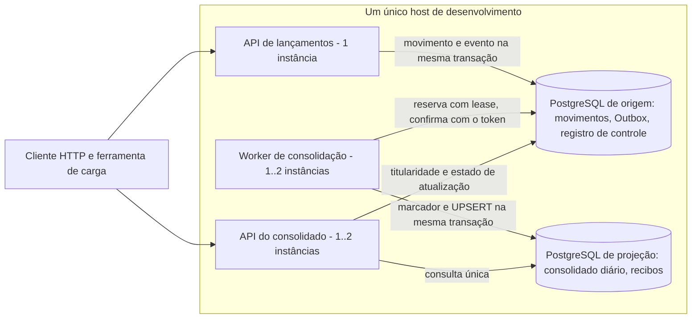
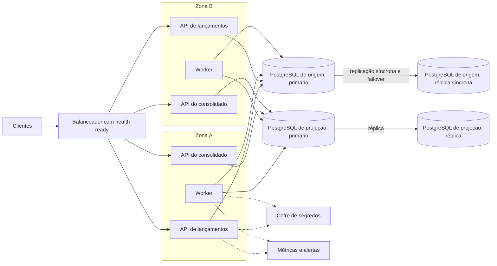

# Alta disponibilidade: o que existe, o que falha e o que se propõe

Este documento responde a uma pergunta: **o que acontece com este sistema quando uma parte dele falha, e como seria uma arquitetura de produção que tolerasse mais falhas?** Ele separa, em cada afirmação, quatro estados que não se misturam:

| Rótulo | Significado |
|---|---|
| **implementado** | Existe no código desta versão e tem teste automatizado ou verificação própria. |
| **medido** | Foi observado em laboratório, numa máquina de desenvolvimento, e registrado em [verificacao.md](verificacao.md), [carga-consolidado.md](carga-consolidado.md) ou nos checkpoints. Não vale para produção. |
| **proposto** | É um desenho sugerido. **Nada do que é proposto está implementado nem foi exercitado.** |
| **limite** | É uma restrição ou uma lacuna conhecida, declarada para não ser lida como garantia. |

**Conclusão em uma frase.** A versão atual separa os domínios de falha da escrita e da consolidação (**implementado**, **medido**), mas roda toda num único host e **não é uma arquitetura de alta disponibilidade** (**limite**). A arquitetura de produção descrita na seção 5 é uma **proposta**.

Documentos relacionados: o desenho local está em [arquitetura.md](arquitetura.md), a recuperação por reconstrução em [recuperacao.md](recuperacao.md), as medições de carga em [carga-consolidado.md](carga-consolidado.md).

## 1. Topologia atual (laboratório)

- **implementado:** a API de lançamentos grava o movimento e o evento da Outbox na mesma transação e não conhece a projeção; o Worker e a API do consolidado são processos separados, com banco próprio (ADR-1 e ADR-10 em [arquitetura.md](arquitetura.md)).
- **implementado:** podem existir vários Workers (reserva durável com lease de 45 s, ADR-14) e várias APIs do consolidado (são sem estado, apoiadas no JWT).
- **medido:** as combinações de uma a duas instâncias foram exercitadas em L3 (2 APIs do consolidado e 2 Workers) e em F08 (seção 3).
- **limite:** todos os processos e os dois PostgreSQL estavam na **mesma máquina**. Um segundo processo no mesmo host protege contra a queda de um processo, não contra a queda do host, do disco ou do banco.
- **limite:** a duplicação de URLs usada nos ensaios foi alternada pela ferramenta de carga; **não há balanceador**, cache, broker, cluster nem autoscaling.

**Esta topologia não é alta disponibilidade.** Ela demonstra os mecanismos (isolamento de falha, reserva, retomada, reconstrução) que uma topologia de produção reaproveitaria.

## 2. Pontos únicos de falha da versão atual

Cada linha descreve o que acontece, com o rótulo do estado da afirmação, o que **já mitiga** e o que **falta**.

| Ponto único | Efeito | O que já mitiga | O que falta |
|---|---|---|---|
| **Host** (máquina única) | Tudo para: lançamentos, posição e consolidado. **limite** | Nada em hardware. Os dados confirmados sobrevivem ao reinício do banco porque o volume é preservado (**medido**, sondagem de reinício do P03). | Segundo host, outra zona, backup fora da máquina. **proposto** (seção 5). |
| **API de lançamentos** (1 instância) | Sem ela não há escrita nem posição por instante. **limite** | É sem estado (JWT): outra instância pode assumir sem migração de sessão. A repetição segura de POST pela `Idempotency-Key` permite ao cliente reenviar (**implementado**, T05 a T08). | ≥ 2 instâncias atrás de balanceador com `health/ready`. **proposto**. |
| **Banco de origem** | Perda ou indisponibilidade = **indisponibilidade dos lançamentos** e, por consequência, também do consolidado (a API do consolidado lê a origem para autorizar e informar o estado). **limite**, e pressuposto declarado: *origem saudável*. | Com o banco fora, a API devolve `503 dependency_unavailable` em prazo curto (≈ 2 s), sem saldo substituto, e volta sozinha com o banco (**medido**, P03). | Réplica síncrona ou serviço gerenciado com failover e backup/PITR. **proposto**. A perda definitiva do banco de origem está **fora do alcance** desta versão. |
| **Banco de projeção** | As consultas do consolidado respondem `503`; a **escrita continua** de lançamentos; a Outbox acumula. | Independência da escrita (**medido**: C3, e F08 caso c com o container parado por cerca de 35 s: 600/600 POST aceitos, 34 de 60 sondas por URL em 503, pendência mais antiga de 39,5 s, backlog de até 396 eventos, convergência 0,61 s depois do fim do produtor). A projeção é **reconstruível** a partir dos movimentos imutáveis (**implementado**, ADR-15, ensaiado em pequena escala). | Réplica da projeção ou, como plano B, reconstrução (seção 3); a reconstrução em 100.000 movimentos **não foi medida**. |
| **Worker único** | A consolidação para; a **escrita continua**; o consolidado passa a `stale` e a pendência cresce. | Retomada sem duplicata (marcador e UPSERT na mesma transação) e recuperação sem intervenção quando o Worker volta (**medido**: C1, C2, C4, e F08 caso a). Com dois Workers, o segundo assume o evento da reserva vencida (**medido**: ~47 s com reserva de 45 s). | Pelo menos dois Workers em hosts distintos. O mecanismo **já existe** (**implementado**); a topologia, não (**proposto**). |
| **API do consolidado única** | As consultas param; a **escrita continua**. | É sem estado e reinicia sem efeito sobre os dados (**medido**: C5, e F08 caso b: 600/600 POST aceitos, as 17 sondas daquela URL sem resposta, a outra URL respondeu todas as 43). | ≥ 2 instâncias atrás de balanceador **health-aware**. **proposto**; o balanceador **não foi exercitado** (**limite**). |
| **Rede / loopback** | Todos os processos conversam por `127.0.0.1`. Uma rede real introduz partição, latência e perda que não foram exercitadas. **limite** | Prazos curtos de conexão e comando, classificação de falha de dependência e *backoff* (ADR-6, ADR-13). | Testes de partição e de latência em rede real. **proposto**. |
| **Disco / volume do container** | Perda do volume = perda dos dados daquele banco. **limite** | Nenhuma cópia de segurança nesta versão. Os fatos (movimentos) da origem permitem refazer a projeção, **não** a origem. | Backup e restauração testada; armazenamento replicado. **proposto**. |
| **Chave JWT compartilhada** | A chave simétrica é a mesma nas duas APIs e na ferramenta que emite tokens; vazamento compromete todas. **limite** | Fora do repositório (variável de ambiente ou user-secrets). | Cofre de segredos, rotação, chave assimétrica com JWKS. **proposto** (evolução 7 em [arquitetura.md](arquitetura.md)). |
| **Configuração** | Connection strings e chave por variável de ambiente, editadas à mão; um valor errado derruba o processo. **limite** | Os processos recusam iniciar com configuração ausente, inválida ou igual entre origem e projeção (**implementado**); a promoção de uma reconstrução valida o vínculo com a origem (**implementado**, ADR-15). | Configuração gerida e versionada fora do host. **proposto**. |
| **Coordenador administrativo** (`--backfill`, `--rebuild`) | Operações manuais; a exclusividade é um lock consultivo no banco de destino. **limite** | Exclusividade por destino e idempotência dos estágios (**implementado**). | Dois coordenadores em **processos separados reais** não foram exercitados (só um concorrente simulado por sessão SQL): **limite**. |

## 3. Modos de falha e recuperação por componente

### 3.1 Matriz de modos de falha

Uma linha por componente e falha: como se percebe, o efeito sobre os fluxos (e não uma lista de tecnologias), como se recupera e o que a recuperação garante e **não** garante. "Detecção" lista só o que existe nesta versão: `health/ready` de cada processo, `--status` (pendentes, reservados, expirados, idade do mais antigo, quarentena, tamanhos), `/diagnostics/instance` (contadores por instância, inclusive perdas de posse), `freshness` na resposta do consolidado e os códigos de saída dos comandos administrativos. Não há alerta automático (**limite**).

| Componente / falha | Detecção | Impacto nos lançamentos | Impacto nas consultas | Recuperação | Garantia e limite |
|---|---|---|---|---|---|
| **Worker**: queda abrupta | `--status`: pendentes e idade do mais antigo crescem; consolidado responde `stale`; sem `/health/live` do processo | Nenhum: POST segue `201` (**medido**: C1, F08 a) | Posição por instante normal; consolidado `stale`, com o valor da projeção até então | **Automática**: a reserva (45 s) vence e outro Worker, ou o mesmo reiniciado, retoma (**medido**: ~47 s, R04) | Sem duplicata nem perda (marcador no destino). A reserva não dá exclusão mútua absoluta. Com um só Worker a consolidação fica parada até alguém reiniciá-lo |
| **Projeção** indisponível, prazo longo | `/health/ready` do Worker `Degraded`/`503`; do consolidado `503`; `--status` com backlog e idade crescentes | Nenhum (**medido**: F08 c, 600/600 POST) | Consolidado `503 dependency_unavailable`, nunca saldo substituto; posição por instante normal | **Automática** ao voltar: *backoff* de 1 s a 30 s, sem tentativa gasta nem quarentena; convergência de 0,61 s depois do produtor em F08 c | Backlog proporcional ao volume (F08 c: 396 eventos, 39,5 s de pendência, 34 de 60 sondas em `503` por URL); **sem purge** da Outbox |
| **Evento inválido** | `--status` e `--list-quarantine`; `freshness` nunca `complete` com quarentena no recorte | Nenhum | Recorte afetado fica `stale` | **Administrativa**: `--requeue` com dry-run, digest do plano e trilha (R06) | Só defeito do próprio evento vai à quarentena; não edita payload; se a causa persiste, o evento volta |
| **Perda do banco de projeção** | Consolidado `503`; `--verify` aponta divergência ou inalcançável (saída 2/4) | Nenhum | Consolidado fora até a nova projeção; posição por instante normal | **Administrativa**: reconstrução em banco novo (`plan`, `capture`, `replay`, `reconcile`, `enable`, `promote`) | Reconstruível dos movimentos imutáveis; consumidores e APIs parados e breve interrupção na promoção; tempo derivado da vazão do bootstrap (~27 min por 100.000 eventos com um Worker, ordem de grandeza, **não medido** para a reconstrução, **não é compromisso**); teto de 250.000; servidor perdido sem o banco anterior **não demonstrado** |
| **Banco de origem** indisponível | `/health/ready` da API de lançamentos `503`; erros `503 dependency_unavailable` | **Param** (`503` em prazo curto, nunca `201` sem commit; **medido**: reinício do PostgreSQL, P03) | Consolidado também `503` (a origem autoriza e informa o estado); posição por instante `503` | Volta sozinha se o banco voltar com os dados (volume preservado); o cliente repete com a mesma `Idempotency-Key` | **Pressuposto: origem saudável.** Perda definitiva do banco ou do volume está **fora do alcance do código**: replicação, failover e backup da plataforma (**proposto**, seção 4) |
| **Host** | Todos os `health` deixam de responder | Param | Param | Reiniciar o host e os processos; os dados dependem do volume | **Limite:** host único. Nenhuma tolerância implementada; segundo host e zonas são **propostos** (seção 5) |
| **Rede** (partição, latência) | Timeouts e `503` nas dependências; `health/ready` `Unhealthy` | `503` se a origem não responde; nunca `201` sem commit | `503` conforme a dependência afetada | Automática quando a rede volta (prazos curtos, *backoff*) | Só loopback foi exercitado; partição e latência reais **não** foram testadas (**limite**) |
| **Armazenamento / backlog** (disco cheio, Outbox crescendo) | `--status` (tamanho da Outbox e de `processed_events`); log do PostgreSQL | Esperado, **não exercitado**: falha de escrita se o disco da origem encher | Atraso crescente do consolidado | Administrativa: liberar espaço, arquivar. **Não existe purge nem arquivamento** | **Limite:** retenção é conservar; sem alerta de capacidade; crescimento medido em 100.000 eventos (origem 89,3 MiB, projeção 21,7 MiB) |
| **Configuração / chave JWT** | O processo recusa iniciar (configuração ausente, inválida ou igual entre origem e projeção); `401` em todas as rotas se a chave diverge | Param se a API não sobe; `401` para tokens de outra chave | Idem | Corrigir variáveis e reiniciar | Chave simétrica compartilhada; rotação, cofre e JWKS são **propostos**, não implementados |
| **Coordenador** (`--backfill`, `--rebuild`): concorrência / split-brain | Saída `3` no `--backfill`; saída `4` ("exclusividade por alvo") na reconstrução | Nenhum | Nenhum | Repetir o comando depois que o outro terminar; estágios idempotentes | Lock consultivo coordena só comandos deste coordenador; dois coordenadores de reconstrução em **processos separados reais não foram exercitados** (**limite**) |

### 3.2 Detalhe por componente

**Queda abrupta de um Worker.**
- **implementado:** a reserva do evento (lease de 45 s, com token) vence sozinha; outro Worker, ou o mesmo reiniciado, reserva o evento de novo; a soma é protegida pelo marcador do destino, que a reserva não substitui (ADR-14).
- **medido:** com o processo encerrado por PID, o evento foi recuperado em cerca de 47 s (R04, sondagem de P08 A); no ensaio F08 caso a, com dois Workers, o que sobrou continuou consumindo (backlog de até 20 eventos) e 600 de 600 POST foram aceitos.
- **limite:** a reserva **não** garante exclusão mútua absoluta de execução. Um Worker lento pode alcançar a projeção depois de a reserva ter vencido; por isso a deduplicação financeira continua no destino.

**Indisponibilidade prolongada da projeção.**
- **implementado:** falha de infraestrutura e de ambiente não conta tentativa do evento, não envia nada à quarentena e entra em *backoff* de 1 s a 30 s; a Outbox acumula (ADR-13).
- **medido:** F08 caso c (seção 2, linha do banco de projeção) e C4 (seis tentativas falhas observadas, recuperação sem intervenção).
- **limite:** **não há purge** da Outbox; o crescimento é medido por `--status` e a retenção é conservar. Uma indisponibilidade muito longa acumula backlog proporcional ao volume de lançamentos.

**Evento defeituoso, quarentena e reprocessamento.**
- **implementado:** só defeito do próprio evento leva à quarentena, após cinco tentativas; o reprocessamento é administrativo, com dry-run, seleção finita, digest do plano, trilha persistida e repetição idempotente. Não edita payload.
- **medido:** R06a a R06d e a sondagem real do comando.

**Perda do banco de projeção.**
- **implementado:** reconstrução em banco **novo** ao lado do anterior: captura do conjunto finito de movimentos a partir de um snapshot, replay idempotente, reconciliação do mesmo conjunto, habilitação e promoção administrativa; verificação financeira independente (`--verify`) em três modos (ADR-15, [recuperacao.md](recuperacao.md)).
- **medido (pequena escala):** testes R09 a R13 e as sondagens com processos reais (o maior conjunto reconstruído tinha dezenas de movimentos).
- **limite:** consumidores e APIs conhecidos ficam **parados** durante a operação e há uma breve interrupção das consultas na promoção; não é reconstrução online contínua nem tem retorno transparente. A promoção exige que o banco anterior aceite conexão: a recuperação de um servidor definitivamente perdido **não está demonstrada**. O teto de captura é de 250.000 movimentos.
- **Ordem de grandeza do tempo (derivada, não medida):** a única vazão medida em 100.000 movimentos é a do **bootstrap com um Worker**, cerca de 61 eventos/s, isto é, 1.645 s (cerca de 27 min) no executor e 1.591,5 s na reprodução da governança. A reconstrução usa o mesmo applier, mas sem a reserva por evento e dentro de um único processo; a captura e o replay **não foram medidos** nessa escala. Use os ~27 min apenas como referência de ordem de grandeza, **não como compromisso** (um RTO de reconstrução exige medição própria).

**Perda do banco de origem.**
- **limite:** fora do alcance. A origem é a fonte dos fatos; sem ela não há lançamentos nem como reconstruir a projeção. A proteção é responsabilidade da plataforma: backup, replicação e failover. **proposto** (seção 5).

**Split-brain do coordenador.**
- **implementado:** o coordenador do bootstrap e os estágios da reconstrução adquirem um lock consultivo (`--backfill`: o segundo coordenador sai com código 3; reconstrução: recusa imediata, saída 4) e só quem adquiriu libera.
- **medido:** dois `--backfill` simultâneos (saídas 0 e 3, sondagem de P07), testes C9h, EX02 e R13c a R13e.
- **limite:** dois coordenadores de **reconstrução** em processos separados reais não foram exercitados (só um concorrente simulado por sessão SQL). O lock coordena apenas comandos deste coordenador; SQL direto não o respeita.

## 4. Política de dados

Tudo o que não está marcado como **implementado** é **proposto**.

- **Durabilidade do commit na origem — implementado.** O movimento e o evento da Outbox são gravados na mesma transação; só o `COMMIT` do PostgreSQL confirma os dois, e o `201` só sai depois dele. A durabilidade depende da configuração do PostgreSQL e do armazenamento (esta versão usa os padrões do container de laboratório).
- **Replicação e failover da origem — proposto.** Não há réplica nesta versão. Numa réplica **síncrona**, o commit só retorna depois de a réplica confirmar, o que permite RPO 0 para movimento confirmado, ao custo de latência e de a indisponibilidade da réplica poder bloquear escritas. Numa réplica **assíncrona**, o primário confirma antes da réplica receber: em falha definitiva do primário há uma **janela de perda** (os commits ainda não replicados se perdem, o que neste sistema significa movimentos confirmados ao cliente que desaparecem). **Desenhar uma réplica não promete RPO 0**; só a replicação síncrona, ou um serviço gerenciado que a garanta, sustenta esse alvo, e o valor precisa ser validado.
- **Backups e restauração testada — proposto.** Não há backup nesta versão. Um backup só conta depois de uma restauração testada, com tempo medido; ele cobre a origem (a fonte dos fatos) e é a única proteção contra corrupção lógica replicada.
- **A projeção é derivada e reconstruível — implementado.** Ela se refaz dos movimentos imutáveis (ADR-15), em pequena escala exercitada. A reconstrução lógica **não substitui** alta disponibilidade (há janela com consultas paradas) **nem** backup (sem a origem não há o que reconstruir).
- **Retenção da Outbox — implementado como política.** Conservar, sem purge; o crescimento é medido por `--status`. Custo: espaço crescente na origem e custo de diagnóstico que cresce com o histórico da conta ([carga-consolidado.md](carga-consolidado.md), seção 7). Qualquer arquivamento futuro precisa provar que não destrói deduplicação, replay nem reconciliação.
- **O volume Docker não é backup.** O volume do `docker-compose.yml` mantém os dados entre reinícios do container; ele está no mesmo host e no mesmo disco, some com um `docker volume rm` e não protege contra perda do disco ou do host.

## 5. Arquitetura proposta de produção

> **Nada desta seção está implementado.** É um desenho para discussão, com o custo de cada elemento e a condição que o torna desnecessário.

| Elemento proposto | O que ganha | O que custa | O que o torna desnecessário |
|---|---|---|---|
| ≥ 2 instâncias da **API de lançamentos** atrás de balanceador com `health/ready` | Sobrevive à queda de uma instância e permite atualização sem parada. A repetição por `Idempotency-Key` já torna segura a nova tentativa do cliente. | Balanceador, política de verificação de saúde, configuração idêntica entre instâncias. | Se a indisponibilidade de uma única instância for aceitável para o negócio. |
| ≥ 2 instâncias da **API do consolidado** com o mesmo balanceador | Consultas continuam com uma instância fora. Reparte as 50 consultas/s. | Idem; o balanceador precisa respeitar a readiness (`503` até `live`). | Se o consolidado puder ficar fora por janelas longas. |
| ≥ 2 **Workers** em hosts ou zonas distintas | Retomada automática pelo vencimento da reserva (45 s) sem intervenção. **O mecanismo já existe.** | Contenção maior na Outbox e no agregado por conta e dia (seção 7). | Se um único Worker acompanhar o volume e a retomada manual for tolerável. |
| **PostgreSQL de origem** com réplica síncrona ou serviço gerenciado com failover, backup e restauração testada | É o ponto único mais crítico: sem a origem não há lançamentos. A replicação síncrona dá RPO 0 no commit. | Custo de infraestrutura, latência extra de commit, operação de failover. | Se a plataforma já oferecer o banco gerenciado com essas garantias. |
| **Projeção** com réplica, ou **reconstrução como plano B** | A réplica reduz o tempo de volta das consultas; a reconstrução evita custo permanente. | Réplica: custo contínuo. Reconstrução: janela administrativa e tempo proporcional ao volume (não medido em escala). | Se o tempo de reconstrução medido couber no objetivo de recuperação. |
| **Zonas distintas** | Sobrevive à perda de uma zona. | Latência entre zonas, replicação, custo. | Se a perda de uma zona for risco aceito. |
| **Segredos em cofre** e rotação | Elimina a chave simétrica compartilhada em variável de ambiente. | Dependência do cofre e de um emissor de identidade real. | Se o serviço ficar restrito a laboratório. |
| **Observabilidade**: backlog da Outbox, idade da pendência mais antiga, quarentena, reservas perdidas | Detecta o início de uma degradação antes do consumidor perceber. **Hoje há `--status` e o diagnóstico por instância**, sem plataforma de métricas. | Coletor, painéis e alertas, disciplina de atributos sem dados sensíveis. | Se a operação se resumir a um ambiente de laboratório. |

## 6. Objetivos propostos (não são resultados)

Os valores abaixo são **alvos propostos para validar**, não medições. O laboratório mediu **convergência** (o atraso entre o fim do produtor e o consolidado coerente: de 0,34 s a 0,64 s nos ensaios de escrita) e a **recuperação de um mecanismo** (reserva vencida: ~47 s); **não mediu RTO nem RPO** de uma falha de componente em produção.

| Componente | RPO proposto | RTO proposto | Fundamento e o que falta validar |
|---|---|---|---|
| Lançamentos (API) | 0 para movimento confirmado (commit síncrono na origem) | Minutos, limitados pela verificação de saúde e pela troca de instância | Exige banco de origem replicado de forma síncrona; **não há réplica nesta versão**. |
| Banco de origem | 0 (réplica síncrona) | Minutos (failover gerenciado) | Totalmente dependente da plataforma; **fora do alcance** do código. |
| Consolidado (consulta) | Backlog recuperável: nenhum fato se perde, porque a Outbox e os movimentos são conservados | Convergência medida mais o tempo de reiniciar o processo | A convergência medida vale para o laboratório (< 1 s com produtor encerrado); sob falha prolongada ela cresce com o backlog. |
| Projeção (perda do banco) | 0 em dados, porque é reconstruível dos movimentos imutáveis | Proporcional ao volume: **ordem de grandeza de dezenas de minutos para 100.000 movimentos, derivada da vazão do bootstrap e não medida** | Requer medir a captura e o replay em escala e aceitar a janela de consultas paradas. |

## 7. Escala horizontal

- **implementado:** as APIs não guardam estado (autenticação por JWT); podem existir várias instâncias de cada uma.
- **medido:** L3 com 2 APIs do consolidado e 2 Workers sobre o mesmo par de bancos: 3.000 consultas úteis em 3.000 programadas, 1.500 por instância; 600 de 600 POST; convergência em menos de 1 s depois do produtor. A vazão de **um Worker** é de cerca de 61 eventos/s em bootstrap.
- **limite:** os Workers disputam a mesma Outbox e atualizam o mesmo agregado por conta e dia; o UPSERT **serializa por linha**, de modo que contas muito quentes limitam o ganho de mais Workers, e a contenção na Outbox cresce com o número deles. A escala maior que a testada não foi medida.
- **limite:** os bancos são um limite **vertical**: adicionar instâncias de API ou de Worker não aumenta a capacidade do PostgreSQL de origem nem da projeção. Fragmentar o banco não é proposto nesta fatia.
- **limite:** o balanceador **health-aware** não foi exercitado; a ferramenta de carga alternou as URLs de duas instâncias. A duplicação de URLs mostra o atendimento por duas instâncias, não failover.

## 8. Broker como alternativa

O desenho atual usa a Outbox no banco, com *pull* pelo Worker (ADR-10). A adoção de um broker é uma alternativa **documentada, não implementada**.

- **Quando adotar** (as mesmas condições da ADR-10): mais de um consumidor independente do mesmo fato; consumidores fora da equipe ou da rede; polling da Outbox como gargalo medido; necessidade de ordenação ou reprocessamento por partição.
- **O que custa:** um componente a mais que também pode cair, relay a partir da Outbox, idempotência em cada consumidor, retenção e limpeza.
- **O que muda no código:** a fronteira de transporte do consolidado é a interface `IConsolidationSource`; um relay a partir da Outbox poderia alimentar um broker e um novo `IConsolidationSource` consumiria dele, **sem mudar a transação do registro**. A reserva durável deixaria de ser necessária para os consumidores que lessem do broker.
- **Em termos de alta disponibilidade:** o broker teria de ser, ele mesmo, replicado; sem isso trocaria um ponto único por outro.

## 9. Tabela de evidências

Cada linha liga uma afirmação ao teste, à sondagem ou ao ensaio e ao documento onde o resultado está. Teste automatizado = execução local do executor; a governança reexecutou os testes automatizados (unidade e integração) nos pareceres de P08 B (vínculo) e P08 C. A CI do commit publicado não cobre as sondagens, as mutações nem os ensaios de carga.

| Afirmação | Evidência | Documento |
|---|---|---|
| A escrita continua com o Worker parado, a projeção inalcançável ou a API do consolidado parada | C1 a C5 (testes) e sondagem com processos reais de P07 | [verificacao.md](verificacao.md), seções 9.2 e 9.5 |
| Retomada sem duplicata e sem perda | C6a, C6b, C7, R02, R03 | [verificacao.md](verificacao.md), seções 9.2 e 10.1 |
| Recuperação de um Worker morto pelo vencimento da reserva | R04 e sondagem real (~47 s) | [verificacao.md](verificacao.md), seção 10.1 |
| Quarentena e reprocessamento administrativo | R06a a R06d, sondagem real | [verificacao.md](verificacao.md), seções 10.1 e 10.4 |
| Verificação financeira independente | R09a a R09c (sete controles negativos), sondagem real | [verificacao.md](verificacao.md), seção 11.1 e [recuperacao.md](recuperacao.md) |
| Reconstrução, exclusividade por destino, promoção parcial e vínculo da origem | R10 a R13j e as sondagens de P08 B | [verificacao.md](verificacao.md), seções 11 a 13 e [recuperacao.md](recuperacao.md) |
| 50 consultas/s, perda 0%, p99 desde a programação ≤ 31 ms (duas repetições por cenário) | L1, L2 e L3, ferramenta em chegadas abertas | [carga-consolidado.md](carga-consolidado.md), seção 5 |
| Reproduzido pela governança (L1) | Parecer de P08 C: golden próprio e uma repetição de L1 (3.000 úteis de 3.000) | [verificacao.md](verificacao.md), seção 15 |
| Falha de um componente durante 10 POST/s: 600 de 600 aceitos | F08 casos a, b e c | [carga-consolidado.md](carga-consolidado.md), seção 5 |
| Resposta de falha do consolidado em ≤ 2 s para conexão recusada; `503 consolidation_not_ready` até `live` | C3, `NotReady_*` | [verificacao.md](verificacao.md), seção 9.2 |
| Vazão do bootstrap (~61 eventos/s, 100.000 em ~27 min com um Worker) | Golden do executor e golden da governança | [carga-consolidado.md](carga-consolidado.md), seção 3 |
| Banco de origem reiniciado: `503` em prazo curto e volta sem perder dado | Sondagem de reinício (P03) | [verificacao.md](verificacao.md), seção 4.1 |
| **Não medido:** balanceador, réplicas, failover, rede real, reconstrução em 100.000 movimentos, dois coordenadores em processos separados | Nenhuma | Seções 2 a 7 deste documento |
