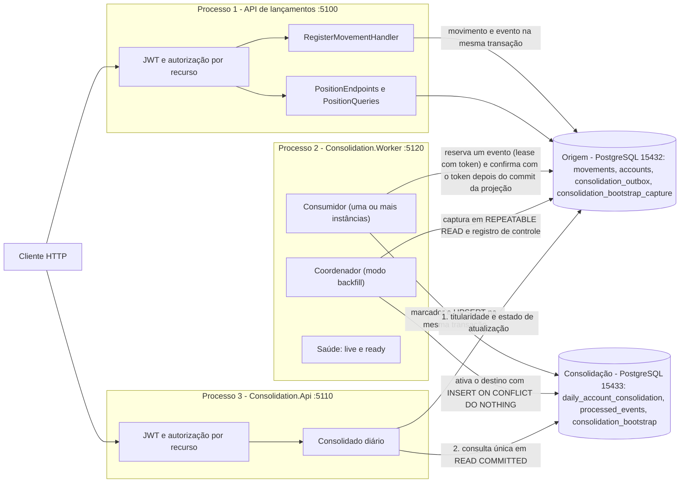
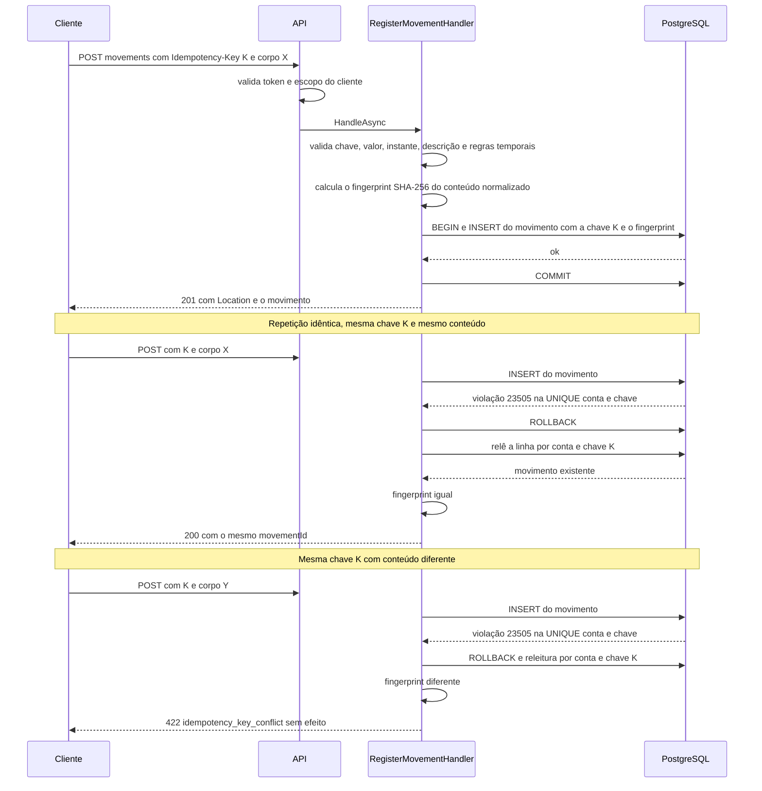
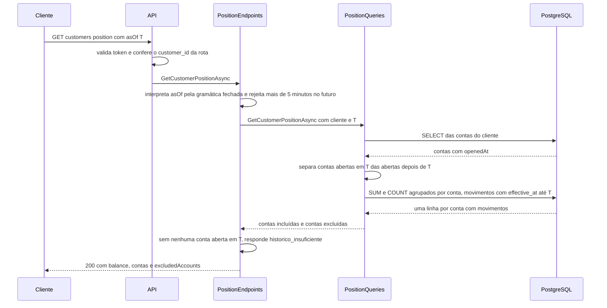
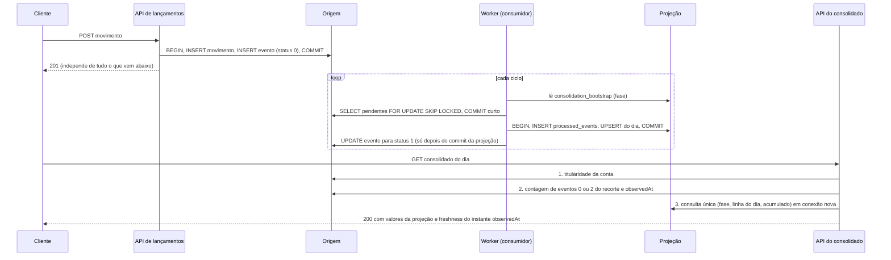
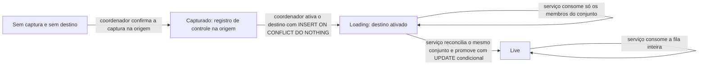

# Arquitetura

Este documento descreve o que está implementado em `FinancialTransactions` e por que foi desenhado assim. As hipóteses de negócio (H1 a H15) estão em [escopo.md](escopo.md); a correspondência requisito → código → teste e os resultados datados estão em [verificacao.md](verificacao.md); o ensaio de carga está em [carga.md](carga.md). A única seção que fala de coisas **não implementadas** é a última, [Evoluções e o que faria diferente com mais tempo](#evoluções-e-o-que-faria-diferente-com-mais-tempo).

## Visão

O sistema é um **registro de movimentações financeiras** (créditos e débitos em contas de clientes) com duas leituras derivadas:

- a **posição por instante**: o saldo de uma conta ou de um cliente em um instante `asOf`, calculado a partir dos movimentos com `effectiveAt <= asOf`, direto na origem (inalterada desde P01);
- o **consolidado diário**: créditos, débitos, líquido e fechamento acumulado por conta ou cliente e **dia de negócio** (`America/Sao_Paulo`), mantido por uma projeção própria, em **outro processo e outro banco**, alimentada por trabalho durável gravado na origem (H15, ciclo P07).

Três estados atravessam o consolidado e são mantidos distintos no código, nos testes e aqui: **evento enfileirado** (linha na Outbox da origem), **evento aplicado** (marcador e soma na projeção) e **resposta comprovadamente completa no recorte e no instante declarados** (`freshness`).

O que ele **não** é:

- não autoriza operações nem limita saldo: um débito é registrado mesmo que deixe o saldo negativo, porque o fato já ocorreu (H1);
- não corrige nem estorna movimentos: não há atualização nem exclusão de movimentos pela API;
- não gerencia cadastros: clientes e contas são semeados pela migration (H2);
- não tem broker de mensagens, cache ou posição materializada na origem. A comunicação assíncrona do consolidado usa trabalho durável no banco (ADR-10).

## Componentes e fronteiras

São **três processos** e **dois bancos**. A API de lançamentos **não conhece** a consolidação: não referencia seus projetos, não tem a connection string da projeção e a sua readiness só olha a origem (I7). A API do consolidado **depende da origem para autorizar** (a titularidade da conta está lá) e para informar o estado de atualização; sem a origem ela responde `503`, e isso é declarado, não escondido. `DevToken` e `LoadTest` são ferramentas de console separadas: não fazem parte das APIs e não são referenciadas por elas.

| Projeto | Responsabilidade | Depende de |
|---|---|---|
| `src/FinancialTransactions.Domain` | Tipos e regras puros: `Movement`, `MovementAmount`, `MovementRules`, `IdempotencyKey` (validação e fingerprint), `InstantParser`, `Account`, `Customer`. Sem I/O. | nada além da biblioteca base |
| `src/FinancialTransactions.Infrastructure` | Persistência da origem: `FinancialTransactionsDbContext`, configurações snake_case, migrations `InitialSchema` (com seed), `AddConsolidationOutbox`, `AddOutboxLeaseAndAdminTrail` (reserva e trilha administrativa) e `AddProjectionRegistry` (projeção ativa depois de uma promoção), `MovementAmountConverter`, `PositionQueries` (SUM e COUNT no banco), `DependencyFailure` (classificação única de "o banco não respondeu"). | Domain, EF Core, Npgsql |
| `src/FinancialTransactions.Api` | Transporte e orquestração da escrita: Minimal APIs, autorização por recurso (`AccountAccess`), `ProblemDetails`, `RegisterMovementHandler` (grava movimento **e** evento da Outbox), health checks, limite de corpo, logs. | Auth, Infrastructure (e, por ela, Domain) |
| `src/FinancialTransactions.Auth` | `AddFinancialTransactionsJwt`, `CustomerScope`, `AuthDefaults`: o JWT local compartilhado pelas duas APIs. **Não referencia nenhum outro projeto da solução** (teste de grafo). | pacote de JWT |
| `src/FinancialTransactions.Consolidation` | Núcleo da consolidação: `ConsolidationDbContext` e migration `ConsolidationSchema`, `BusinessDay`, `DailyConsolidationApplier`, `IConsolidationSource`/`OutboxConsolidationSource`, `FailureClassifier`, `ConsolidationConsumer` (laço de uma instância), `ConsolidationInstance` e contadores, `BootstrapCoordinator`, `BootstrapReconciler` e `BootstrapPromoter` (reconciliação e promoção com exclusividade local), `QuarantineAdmin` e `ConsolidationStatusReader` (comandos administrativos), `ProjectionVerifier` (verificação financeira somente leitura) e `RebuildCoordinator` (reconstrução em banco paralelo, migration `AddRebuildRecovery`), `ConsolidationQueries` e `UnresolvedEventsQuery`, `IConsolidationConnectionFactory` (papéis), `IConsolidationDiagnostics`, saúde e pontos de falha (inertes em produção). | Domain, Infrastructure, EF Core, Npgsql |
| `src/FinancialTransactions.Consolidation.Worker` | Executável com modos: serviço (host web mínimo com `/health/live`, `/health/ready` e `/diagnostics/instance` na porta 5120 e **um** consumidor, de modo que várias instâncias podem coexistir em portas distintas), `--backfill` (coordenador do bootstrap) e os comandos administrativos `--status`, `--list-quarantine` e `--requeue`; os modos de linha de comando não têm Kestrel nem consumidor e terminam com código de saída. | Consolidation |
| `src/FinancialTransactions.Consolidation.Api` | API do consolidado diário (porta 5110): duas rotas autenticadas, orçamento por requisição, saúde. | Auth, Consolidation |
| `tools/FinancialTransactions.DevToken` | Emite um JWT local de desenvolvimento. | pacote de JWT |
| `tools/FinancialTransactions.LoadTest` | Ensaio de carga e reconciliação. Conversa com a API por HTTP e com o banco por SQL. | pacotes de JWT e Npgsql |
| `tests/` | Unidade (xUnit) e integração (xUnit, hosts reais da API de lançamentos, do Worker e da API do consolidado, e dois PostgreSQL reais). | todos os projetos acima |

### Onde cada coisa está

O código está organizado assim, e o desenho acima o reflete:

- **Escrita:** `Api/Endpoints/MovementEndpoints.cs` é a fronteira HTTP e chama `Api/Movements/RegisterMovementHandler.cs`, o caso de uso. O handler recebe pelo construtor o `FinancialTransactionsDbContext` de Infrastructure, o `AccountAccess`, um `TimeProvider` e o `IRegisterMovementFailurePoints` (ponto de injeção de falha dos testes; em produção só existe `NoFailurePoints`). Os contratos e o parsing da requisição ficam em `Api/Movements/MovementContracts.cs`.
- **Leitura:** `Api/Endpoints/PositionEndpoints.cs` é a fronteira HTTP **e** orquestra a leitura (autorização, validação de `asOf`, regras de história insuficiente). Ele recebe `PositionQueries` e `TimeProvider` por parâmetro. `Infrastructure/PositionQueries.cs` faz a seleção de contas e a agregação em SQL pelo `DbContext`. Os contratos de resposta ficam em `Api/Positions/PositionContracts.cs`.
- **Domínio:** `Domain/` não conhece HTTP nem EF Core.
- **Outbox:** `Domain/OutboxEvent.cs` (o evento, criado por `OutboxEvent.ForMovement`) é adicionado ao mesmo contexto e ao mesmo `SaveChanges` do movimento em `RegisterMovementHandler`; a configuração está em `Infrastructure/Configurations/OutboxEventConfiguration.cs`.
- **Consolidação:** `Consolidation/DailyConsolidationApplier.cs` aplica um evento (marcador + UPSERT, uma transação); `ConsolidationConsumer.cs` é o laço; `BootstrapCoordinator.cs` e `BootstrapReconciler.cs` fazem a carga inicial; `ConsolidationQueries.cs` e `UnresolvedEventsQuery.cs` servem a API; `Consolidation.Api/DailyConsolidationService.cs` impõe a ordem origem → projeção e o orçamento por requisição.

### O que separa e o que não separa

Separa: **domínio puro** (regras de valor, tempo e idempotência, testáveis sem banco), **persistência** (mapeamento, migration, consulta de posição) e **transporte** (HTTP, autenticação, mapeamento de erros).

Não separa: **não existe camada de aplicação própria nem portas e adaptadores**. O handler de escrita e os endpoints de leitura vivem no projeto `Api` e dependem diretamente do `DbContext` concreto; `PositionQueries` também usa o `DbContext` diretamente. Não é Clean Architecture, Hexagonal nem outro estilo formal, e o texto não alega isso. A razão é o tamanho do recorte: dois casos de uso, um banco, um processo. Uma camada de portas e adaptadores aqui acrescentaria interfaces com uma única implementação e nenhuma segunda fronteira para testar; os testes de integração exercem o caminho real contra PostgreSQL. Se o sistema ganhasse um segundo adaptador de entrada (por exemplo, consumidor de mensagens) ou de saída, a separação passaria a pagar o seu custo.

## Fluxos

### Registro de movimento, com repetição

A identidade da intenção `(conta, chave)` e o fingerprint do conteúdo ficam **na própria linha do movimento**. A UNIQUE `ux_movements_account_id_idempotency_key` decide a corrida: de várias requisições simultâneas com a mesma chave, o PostgreSQL deixa uma só inserir; as outras recebem `23505` exatamente nessa constraint, revertem e releem a linha vencedora. O filtro é por **nome da constraint**: outra violação única é falha inesperada (500), não repetição. Se a releitura não achar linha (estado inesperado), a resposta é `409 retry_later`, sem repetir o insert.

### Posição do cliente em um instante

O saldo **nunca** é somado em memória a partir de movimentos: o banco devolve uma linha agregada por conta, e a API soma essas parcelas. Conta aberta em `T` e sem movimentos até `T` tem saldo zero (a origem é conhecida); conta aberta depois de `T` não entra na soma e aparece em `excludedAccounts`; se nenhuma conta estava aberta, a resposta é `422 historico_insuficiente`, nunca zero (H6, H7).

### Consolidado diário: do registro à resposta

A **Outbox fica na transação do movimento** porque é isso que impede o par "fato sem evento" e "evento sem fato": não existe um instante em que um exista sem o outro, e a falha antes do commit leva os dois. A **marcação de processado vem depois do commit da projeção** porque o contrário permitiria perder um evento (marcado e nunca somado). Pelo caminho escolhido, o pior caso é o inverso, o evento somado e ainda não marcado, e a reentrega é inofensiva: o marcador em `processed_events` faz a segunda aplicação não somar nada. Não se promete "exactly-once" ponta a ponta: a garantia é *pelo menos uma vez* na entrega e *no máximo uma vez* na soma.

### Bootstrap: o conjunto inicial por identidade

O consolidado precisa começar de um estado conhecido, com a escrita de lançamentos **nunca pausada**. O conjunto inicial é finito, definido por identidade (não por data) e capturado em uma visão consistente:

1. O coordenador (`Consolidation.Worker --backfill`) pega o lock consultivo `pg_try_advisory_lock(hashtext('ft_backfill'))` numa sessão própria, sem pool. Se estiver ocupado, sai com código 3.
2. Lê **os dois lados** sem escrever: o registro de controle da origem (`consolidation_bootstrap_capture`) e a linha `consolidation_bootstrap` do destino. Decide: nenhum dos dois → captura; só a origem → ativa com os valores **da origem** (nunca reenumera, nunca remarca); os dois iguais → nada a fazer (código 0); qualquer divergência → código 4, nada alterado.
3. **Captura** numa transação `REPEATABLE READ` cujo primeiro comando é `SELECT pg_current_snapshot()`: insere eventos (`origin = 1`) para os movimentos visíveis que ainda não têm, marca `bootstrap_id` em **toda** linha da Outbox cujo movimento é visível no snapshot (inclusive os eventos online criados antes), e grava o registro de controle `{bootstrap_id, member_count, snapshot}` **na mesma transação**, mesmo com conjunto vazio. Movimentos confirmados depois do snapshot ficam com `bootstrap_id` nulo e pertencem a `live`.
4. **Ativação** no destino por `INSERT ... ON CONFLICT (id) DO NOTHING` em fase `loading`, seguida de releitura e conferência de identidade e contagem. O coordenador **nunca** faz `UPDATE` no destino e não espera consumo.

Captura e ativação ficam em bancos diferentes e não há transação distribuída: por isso toda etapa é repetível **a partir do registro de controle na origem**. Se o commit da captura tem resultado desconhecido (código 5), nada é presumido; a reexecução consulta o registro.

O **serviço** (cada instância) segue as fases do destino: sem linha válida ele **aguarda sem consumir** (`/health/ready` = `Degraded`, 503); em `loading` consome só os membros do conjunto e, quando nenhum resta pendente ou em quarentena, **reconcilia o mesmo conjunto** (contagem, créditos, débitos, líquido e ids, comparados em memória; a origem agrega por conta e dia com `AT TIME ZONE` do PostgreSQL, uma segunda opinião sobre a conversão feita em .NET); igual, promove `loading → live` numa **única transação local condicional** (`WHERE phase = 'loading'`). Só o serviço promove, e a fase nunca regride. Com várias instâncias, reconciliação e promoção exigem **exclusividade local ao destino** (lock consultivo no banco da projeção, em sessão própria): quem a obtém **relê a fase**; se já encontra `live`, devolve "já concluído" sem comparar nada (comparar a projeção viva com o conjunto inicial, que é menor, produziria uma divergência falsa). Antes de comparar, o `BootstrapReconciler` confere o descritor: `bootstrap_id` e `member_count` da origem e do destino, a cardinalidade real do conjunto (inclusive zero), as linhas marcadas na Outbox e as somas de `movement_count`; contagem igual não basta, ids e valores continuam sendo comparados.

### Bootstrap e fases (visão de estados)

Não existe seta de `Live` para `Loading`, nem o coordenador promove: a fase só avança, e só o serviço a avança.

## Modelo e invariantes

| Tabela | Colunas essenciais |
|---|---|
| `customers` | `id` (PK), `name`, `created_at` |
| `accounts` | `id` (PK), `customer_id` (FK), `currency` (`char(3)`), `opened_at` (`timestamptz`) |
| `movements` | `id` (PK), `account_id` (FK), `type` (`smallint`), `amount` (`numeric(18,2)`), `currency`, `effective_at` e `registered_at` (`timestamptz`), `idempotency_key` (`varchar(128)`), `request_fingerprint` (`char(64)`), `description` (`varchar(140)`, anulável) |
| `consolidation_outbox` (origem) | `sequence` (identity, PK), `event_id` (UNIQUE, = id do movimento), `account_id`, `customer_id`, `type`, `amount`, `effective_at`, `created_at`, `origin` (0 online, 1 inserido pelo bootstrap: procedência), `bootstrap_id` (pertença ao conjunto inicial), `status` (0 pendente, 1 processado, 2 em quarentena), `attempts`, `last_error`, `processed_at`. Índices `(status, sequence)`, `(bootstrap_id, status)` e `(account_id, status)` |
| `consolidation_bootstrap_capture` (origem) | linha única (`id = 1`): `bootstrap_id`, `member_count`, `captured_at`, `snapshot` |
| `daily_account_consolidation` (projeção) | PK `(account_id, business_day)`; `credits`, `debits`, `net` (`numeric(24,2)`), `movement_count`, `max_applied_sequence`, `updated_at`; CHECKs de sinal e de `net = credits - debits` |
| `processed_events` (projeção) | `event_id` (PK), `sequence`, `account_id`, `processed_at` |
| `consolidation_bootstrap` (projeção) | linha única (`id = 1`): `bootstrap_id`, `phase` (`loading` ou `live`), `member_count`, `captured_at`, `applied_at`, `reconciled_at` |

### Dimensionamento dos agregados

Cada coluna monetária da projeção é `numeric(24,2)`: o maior valor positivo é 10^22 − 0,01. Com todos os movimentos no teto de 10^9 (H3), cabem **10^13 − 1 = 9.999.999.999.999** movimentos na mesma linha (conta e dia); 10^13 movimentos já excedem. Totais de fechamento e de cliente somam várias linhas e são lidos em `decimal` do .NET (28 a 29 dígitos significativos). Qualquer estouro é uma **exceção observável**: no UPSERT, o PostgreSQL recusa com `22003` (classificado como falha do evento, vai à quarentena depois de 5 tentativas, sem tocar o agregado); na soma em memória, o `decimal` lança `OverflowException`. Nunca há arredondamento, `double` ou saldo substituto. Os testes preparam um valor acumulado no limite em banco descartável (`C7b`), em vez de gerar volume.

Índices de `movements`: `pk_movements`, `ux_movements_account_id_idempotency_key` (UNIQUE `(account_id, idempotency_key)`) e `ix_movements_account_id_effective_at` (`(account_id, effective_at)`).

**O banco garante:** a UNIQUE de idempotência; as chaves estrangeiras; colunas obrigatórias (`NOT NULL`); `CHECK (amount > 0)` (`ck_movements_amount_positive`); `numeric(18,2)` como **armazenamento** em escala 2.

**O domínio garante, antes de chegar ao banco:** `MovementAmount` (positivo, **no máximo duas casas decimais, rejeitando excesso em vez de arredondar**, teto de 1.000.000.000,00); as regras temporais (`effectiveAt` não anterior à abertura da conta e não mais de 5 minutos no futuro; `asOf` não mais de 5 minutos no futuro); a normalização dos instantes para UTC com precisão de microssegundos; o fingerprint (SHA-256 sobre tipo, valor, instante normalizado e descrição); a gramática fechada de instantes (`InstantParser`).

Uma observação para não superestimar o banco: a coluna `numeric(18,2)` **não** rejeita um valor com mais casas, o PostgreSQL o arredondaria na coerção. Quem rejeita é o domínio, e por isso a rejeição precisa acontecer antes da gravação.

## Decisões

Cada decisão cita onde está no código e o que a verifica. Os nomes de teste são o `DisplayName` (quando existe) seguido do método C#, como aparecem no relatório de testes; a tabela completa está em [verificacao.md](verificacao.md).

### ADR-1 · Registro e posição num processo; consolidação separada, sem broker nem cache (H12, revisada em P07)

- **Contexto:** até P06, o recorte era um sistema de registro com uma consulta derivada, num único banco e num processo. A orientação complementar passou a exigir que o registro continue disponível quando o consolidado diário estiver fora (ver "Fontes e procedência" em [escopo.md](escopo.md)). Isso é incompatível com um consolidado calculado dentro do mesmo processo e do mesmo banco da escrita.
- **Decisão:** a escrita e a posição por instante continuam numa API ASP.NET Core com EF Core e PostgreSQL. O consolidado diário vive em **outros processos** (Worker e API do consolidado) e em **outro banco**, alimentado por uma Outbox transacional na origem (ADR-10). Continuam fora: broker, cache, posição materializada na origem, Aspire e orquestração.
- **Alternativas:** manter tudo num processo (descartada: viola o requisito de independência); Worker hospedado dentro da API de lançamentos (descartada: a queda do processo derrubaria os dois); chamada HTTP síncrona da escrita para a consolidação (descartada: acopla a disponibilidade); cache de posição.
- **Consequências:** o registro de lançamentos não depende de nada do consolidado, o que é verificado por cenário (C1 a C5). O custo é operacional (três processos, dois bancos) e semântico: o consolidado é **eventualmente consistente** e precisa dizer o quanto (ADR-11).
- **Revisão:** se o volume de eventos exigir mais de um consumidor (reserva durável, ciclo P08), ou se surgir um consumidor externo (ADR-10).
- **Onde:** `src/FinancialTransactions.Api/Program.cs` (escrita) e `src/FinancialTransactions.Consolidation.*` (consolidado). **Verificação:** a suíte de integração roda esse desenho contra PostgreSQL real (o ensaio de [carga.md](carga.md) é do ciclo P04, commit `4463e38`, **anterior** à Outbox e aos processos novos: mediu a API de lançamentos sem a segunda escrita do POST e não mediu o consolidado; seus números não valem como medição de P07); `Composition_ProductionHost_ResolvesNoFailurePoints` e `Composition_ProductionWorker_HasNoTestFailurePointsFactoryOrSink` conferem que os hosts de produção não carregam pontos de falha, e `ProjectGraph_AuthReferencesNothing_NoCycle_ApisDoNotReferenceEachOther` confere que a API de lançamentos não referencia a consolidação.

### ADR-2 · Posição por SUM no banco, sem saldo materializado

- **Contexto:** a posição é pedida em instantes arbitrários (`asOf`), inclusive passados, e movimentos com `effectiveAt` antigo podem chegar depois (H9).
- **Decisão:** calcular `SUM` e `COUNT` no banco a cada consulta, com SQL parametrizado (`SqlQueryRaw`), sobre `movements` filtrados por conta e `effective_at <= asOf`.
- **Alternativas:** saldo materializado por conta; cache por `asOf`; reconstruir em memória.
- **Consequências:** o saldo é sempre coerente com os movimentos, inclusive depois de informação tardia; nenhuma invalidação. O custo da consulta cresce com os movimentos da conta até `asOf`.
- **Revisão** (condição registrada em [carga.md](carga.md)): volume de movimentos por conta ordens de grandeza acima do ensaiado (250 a 343 por conta), p95 do GET de posição acima de 250 ms em carga representativa, ou leituras dominando a carga.
- **Onde:** `src/FinancialTransactions.Infrastructure/PositionQueries.cs`. **Verificação:** `PositionQuery_AggregatesInDatabase` (`PositionQueryAggregatesInDatabase`), `T12_HundredCents_SumExactlyOneReal`, `T02_TwoHistoricalCuts_ReturnDifferentBalances`, `T04_LateInformation_ChangesHistoricalPositions`; ensaio de carga e planos de consulta em [carga.md](carga.md).

### ADR-3 · Idempotência na própria linha, não numa tabela de requisições

- **Contexto:** repetições (inclusive simultâneas) da mesma intenção não podem criar dois movimentos.
- **Decisão:** a chave de idempotência e o fingerprint do conteúdo são colunas do movimento, sob UNIQUE `(account_id, idempotency_key)`. Insere-se e trata-se a violação `23505` dessa constraint; relê-se e compara-se o fingerprint.
- **Alternativas:** tabela separada de requisições processadas (com seu ciclo de vida e limpeza); verificação prévia com `SELECT` antes do `INSERT` (sujeita a corrida); lock explícito por chave.
- **Consequências:** a garantia é do banco, não de código de aplicação; não há segunda tabela para manter consistente com a primeira. O replay devolve o movimento original. O fingerprint inclui `description`, que **não** consta na resposta; portanto a resposta sozinha não permite reconstruir um replay de uma requisição que tinha descrição.
- **Revisão:** se for preciso guardar a resposta original exata, ou expirar chaves (hoje sem expiração, fora de escopo).
- **Onde:** `src/FinancialTransactions.Api/Movements/RegisterMovementHandler.cs` (`HandleAsync`, `IsIdempotencyConflict`), `Infrastructure/Configurations/MovementConfiguration.cs`, `Domain/IdempotencyKey.cs`. **Verificação:** `T05_SameKeySameBody_ReplaysSameMovement`, `T05b_SameKeyDifferentBody_IsConflict_NoEffect`, `T06_SameKeySameBody_Concurrent_OneCreatedRestReplayed`, `T06b_SameKeyDifferentBodies_Concurrent_OneCreatedRestConflict`, `T07b_DistinctKeysSameContent_AreTwoLegitimateMovements`, `Fingerprint_ReplayWithSixDigitsReturnedBy201_Is200`, e, na unidade, `IsIdempotencyConflict_TrueOnlyForIdempotencyConstraint` e `IsIdempotencyConflict_FalseForPrimaryKeyViolation`.

### ADR-4 · Instantes: `effectiveAt` com offset, `asOf` com gramática fechada, UTC na resposta, fronteira inclusiva

- **Contexto:** interpretação de data e hora pelo fuso da máquina ou por cultura regional produziria resultados diferentes entre ambientes.
- **Decisão:** `effectiveAt` (POST) exige data e hora completas com `Z` ou `±HH:mm`; `asOf` (GET) aceita o mesmo e, **adicionalmente**, data e hora completas sem offset, lidas como UTC. Tudo por lista fechada de formatos e cultura invariante (`InstantParser`), nunca `TryParse` genérico. As respostas devolvem sempre UTC. A fronteira é inclusiva: a posição em `asOf` conta movimentos com `effectiveAt <= asOf`.
- **Alternativas:** aceitar qualquer formato reconhecido pelo .NET; assumir o fuso do servidor; fronteira exclusiva.
- **Consequências:** o mesmo instante em offsets diferentes é o mesmo movimento e a mesma posição; entradas ambíguas são recusadas com `422 validation_error`. O offset original não é preservado. Em query string, um `+` precisa ser codificado como `%2B`.
- **Revisão:** se clientes precisarem de eco do offset original.
- **Onde:** `src/FinancialTransactions.Domain/InstantParser.cs`, `Domain/Movement.cs` (normalização), `Api/Positions/PositionContracts.cs` (`AsOfParser`). **Verificação:** `F1a_PostEffectiveAtWithoutOffset_Is422_NothingPersisted`, `F1b_PostEffectiveAtNumber_Is422`, `F1c_PostZAndOffsetSameInstant_ReplayAcrossRepresentations`, `F1d_GetAsOfHourOnly_DateOnly_Regional_Text_Are422`, `F1e_GetAsOfCompleteWithoutOffset_IsUtc`, `T02b_SameInstantDifferentOffset_SameBalance`, e os testes de unidade de `InstantParserTests`.

### ADR-5 · JWT HS256 local com `customer_id` e 404 para fora do escopo

- **Contexto:** o recorte precisa proteger o acesso por cliente sem um provedor de identidade externo.
- **Decisão:** JWT HS256 com emissor e audiência fixos (`financialtransactions-dev`, `financialtransactions-api`), assinado por uma chave simétrica de pelo menos 32 bytes fornecida por variável de ambiente ou user-secrets (nunca em arquivo versionado); a claim `customer_id` define o escopo. A autorização é **por recurso**: conta ou cliente de outro escopo, ou inexistente, responde `404`, sem revelar existência, inclusive na repetição de um POST. Token sem `customer_id` válido é `401`.
- **Alternativas:** provedor de identidade real (OIDC); chave assimétrica com JWKS; `403` para fora do escopo.
- **Consequências:** simples de reproduzir localmente; o emissor é uma ferramenta de desenvolvimento (`DevToken`), não um serviço de identidade. A chave simétrica é compartilhada entre quem emite e quem valida.
- **Revisão:** qualquer uso fora de laboratório (rotação de chave, emissor real).
- **Onde:** `src/FinancialTransactions.Auth/` (`AddFinancialTransactionsJwt`, `CustomerScope`, `AuthDefaults`, extraídos da API em P07 para serem compartilhados), `Api/Auth/AccountAccess.cs` (acesso a dados, fica na API de lançamentos) e `Api/Program.cs`. A API do consolidado usa o mesmo JWT e lê a titularidade da conta na origem. **Verificação:** `T11_NoToken_Is401`, `T11b_OtherCustomer_Is404_EvenOnReplay`, `T11c_InvalidTokens_Are401_NothingPersisted`, `T11c_ControlToken_IsAccepted`, `T12_Selection_OtherAccountAndOtherCustomerDoNotLeak`.

### ADR-6 · `503` classificado em vez de retry automático

- **Contexto:** com o banco indisponível, responder `200` com saldo zero seria falso, e um `201` sem commit seria perda silenciosa.
- **Decisão:** falhas de disponibilidade (exceção transitória do Npgsql, `TimeoutException`, `SocketException`, na exceção ou em uma `InnerException`) viram `503 dependency_unavailable` em `ProblemDetails`, com `traceId` e sem detalhes da exceção, em prazo limitado por `Timeout=5;Command Timeout=15` na connection string. Violações de constraint e demais falhas continuam `500`. A API **não** repete POST sozinha: o cliente repete com a mesma `Idempotency-Key`.
- **Alternativas:** retry automático no servidor; circuit breaker; resposta degradada.
- **Consequências:** a decisão de repetir é do cliente, e a idempotência torna a repetição segura: se a tentativa que recebeu `503` não chegou ao commit, a repetição cria; se chegou, devolve `200` com o mesmo movimento.
- **Revisão:** se houver necessidade de absorver quedas curtas sem o cliente perceber.
- **Onde:** `src/FinancialTransactions.Api/Http/ApiExceptionHandler.cs` (`IsDependencyUnavailable`, que desde P07 delega a `Infrastructure/DependencyFailure.cs`, a classificação única usada também pelo Worker e pela API do consolidado). **Verificação:** `T13a_PostWhenDatabaseUnreachable_Is503_WithinDeadline`, `T13b_GetPositionWhenDatabaseUnreachable_Is503_NotZero`, os cinco testes de unidade `IsDependencyUnavailable_*`, e a sondagem de reinício do PostgreSQL contra a API real ([verificacao.md](verificacao.md)).

### ADR-7 · Limite de corpo e health checks sem detalhe

- **Contexto:** a entrada tem um único campo livre (`description`, até 140 caracteres); orquestradores precisam sondar a saúde sem credencial.
- **Decisão:** corpos acima de 16 KB em `/api/v1` são recusados com `413 payload_too_large` (por `Content-Length` antes de ler, e pelo limite do servidor quando não há `Content-Length`). `/health/live` (não toca o banco) e `/health/ready` (`SELECT 1` em até 3 s) são **anônimos** e devolvem só `{"status":"Healthy"}` ou `{"status":"Unhealthy"}`, sem nome de dependência, mensagem de exceção ou connection string. As rotas financeiras continuam exigindo token.
- **Alternativas:** limite apenas no servidor (valeria também para as sondas); sondas autenticadas; corpo detalhado nas sondas.
- **Consequências:** o limite vale só para o grupo financeiro e é exercido pelo mesmo código nos testes; as sondas não vazam informação de ambiente.
- **Revisão:** se as sondas passarem a ser expostas fora de uma rede de confiança.
- **Onde:** `src/FinancialTransactions.Api/Http/RequestBodyLimit.cs`, `Api/Health/`. **Verificação:** `RequestBody_Over16KB_Is413_NothingPersisted` (camada de `Content-Length`; a camada do servidor foi evidenciada pela sondagem contra Kestrel real), `Health_IsAnonymous_ApiIsNot`, `T13c_ReadyIs503_LiveIs200_WhenDatabaseUnreachable`, `T13d_ReadyIs200_WhenDatabaseAvailable`.

### ADR-8 · `TreatWarningsAsErrors` com análise `latest-recommended`

- **Contexto:** a entrega exige compilar sem erros e sem avisos.
- **Decisão:** `Directory.Build.props` fixa `TreatWarningsAsErrors=true`, `EnforceCodeStyleInBuild=true` e `AnalysisLevel=latest-recommended` para todos os projetos (inclusive ferramentas e testes). O portão é o código de saída de `dotnet build -warnaserror`, não a leitura do resumo.
- **Alternativas:** avisos tolerados com revisão manual; análise mais branda.
- **Consequências:** qualquer aviso de compilador ou analisador interrompe o build; o ruído é pago uma vez, na escrita.
- **Revisão:** se uma atualização do SDK introduzir diagnósticos que exijam supressão; supressões não são usadas.
- **Onde:** `Directory.Build.props`. **Verificação:** restore e build `-warnaserror` com código de saída 0 em todos os ciclos e na CI ([verificacao.md](verificacao.md)).

### ADR-9 · Índices atuais, sem índice novo (P04)

- **Contexto:** o ensaio de carga e a análise de planos mediram se a posição precisava de mais índices.
- **Decisão:** manter `pk_movements`, `ux_movements_account_id_idempotency_key` e `ix_movements_account_id_effective_at`. Nenhum índice novo, nenhuma mudança em `PositionQueries`.
- **Alternativas:** índice de cobertura incluindo `type` e `amount`; particionamento.
- **Consequências:** com 125 mil movimentos, a consulta indexada custou décimos de milissegundo; sem o índice dedicado, o planejador usa o índice único pela primeira coluna e filtra o restante; sem nenhum índice iniciado por `account_id`, há varredura sequencial (ordens de grandeza mais lenta).
- **Revisão:** mesma condição do ADR-2; avaliar primeiro um índice de cobertura e só depois uma posição derivada.
- **Onde:** `Infrastructure/Configurations/MovementConfiguration.cs`. **Verificação:** ensaio de carga e planos (`EXPLAIN`) em [carga.md](carga.md), seção "Planos das consultas".

### ADR-10 · Worker com trabalho durável no banco × broker

- **Contexto:** o consolidado precisa receber os fatos sem que a escrita espere por ele nem o perca quando ele estiver fora do ar. Há dois bancos, então o evento atravessa uma fronteira que uma transação local não cobre.
- **Decisão:** **Outbox transacional**: o evento é gravado na mesma transação do movimento (`consolidation_outbox`); um Worker lê os pendentes (`FOR UPDATE SKIP LOCKED` numa transação curta que termina antes de tocar a projeção), aplica na projeção (marcador `processed_events` + UPSERT na **mesma** transação) e só depois marca o evento como processado na origem. Desde o ciclo P08 (parte A) a leitura é uma **reserva durável** (lease com token, ADR-14) e podem existir várias instâncias do Worker; cada instância mantém no máximo um evento em voo.
- **Alternativas:** broker de mensagens (RabbitMQ, Service Bus, Kafka); CDC; chamada HTTP síncrona; fila em memória; Worker dentro da API de lançamentos.
- **Por que não broker agora:** com um produtor, um consumidor e um banco de origem, o broker acrescentaria uma dependência de infraestrutura e um segundo ponto de falha entre o fato e o evento (publicar depois do commit é uma Outbox de qualquer jeito). A Outbox no banco resolve o problema com o que já existe e é verificável com um PostgreSQL local.
- **Condição de adoção do broker (revisão):** mais de um consumidor independente do mesmo fato; consumidores fora da equipe ou da rede; volume que torne o *polling* da Outbox o gargalo medido; necessidade de ordenação ou reprocessamento por partição. Nesse caso a Outbox permanece como origem do evento e passa a alimentar um publicador (relay), sem mudar a transação do registro.
- **Consequências:** garantia *pelo menos uma vez* na entrega e *no máximo uma vez* na soma (marcador). Entrega atrasada é possível e declarada (ADR-11). A Outbox cresce; a política de retenção é **conservar** (nenhum purge automático, para não destruir deduplicação, reprocessamento ou reconciliação), com o crescimento medido por `--status` (ADR-14).
- **Onde:** `RegisterMovementHandler`, `OutboxEventConfiguration`, `OutboxConsolidationSource`, `ConsolidationConsumer`, `DailyConsolidationApplier`. **Verificação:** `C10`/`C15a`/`C15b`/`C15c` (Outbox na transação do movimento), `C6a`/`C6b`/`C7`/`C7b` (atomicidade da projeção e reentrega sem nova soma), `C1` a `C5` (independência e recuperação).

### ADR-11 · Estado de atualização conservador (`freshness`)

- **Contexto:** o consolidado é eventualmente consistente. Uma resposta que afirmasse completude sem prová-la seria pior que nenhuma.
- **Decisão:** a resposta leva `observedAt`, `unresolvedEvents`, `failedEvents`, `stale` e `freshness`. A API **lê a origem primeiro** (eventos da Outbox das contas do recorte, **de qualquer dia**, com `status` 0 ou 2; `observedAt` é o `statement_timestamp()` da instrução de contagem na origem, isto é, o instante em que o servidor recebeu o comando, **anterior ou igual** ao snapshot da contagem: todo commit anterior a `observedAt` está contado, um commit entre `observedAt` e o snapshot pode estar contado (conservador), e `observedAt` **não** é tempo de commit nem garante incluir lançamentos posteriores ao snapshot) e **só depois** abre, em conexão nova e `READ COMMITTED`, a consulta única à projeção (fase do bootstrap, linha do dia e acumulado até o dia, numa mesma instrução SQL).
  - `complete`: **na visão da consulta iniciada em `observedAt`** não foram observados eventos não confirmados para o recorte; a projeção foi lida **depois**. Não se afirma simultaneidade exata entre o relógio, o snapshot da contagem e a resposta, e lançamentos posteriores podem não constar.
  - `stale`: havia eventos não confirmados. É conservador: um evento já somado mas ainda não marcado na origem conta como não resolvido.
  - `unknown`: a leitura diagnóstica da origem falhou **depois** de a autorização ter sido obtida e a projeção ainda pôde ser consultada dentro do orçamento restante; `unresolvedEvents`, `failedEvents`, `stale` e `observedAt` ficam nulos.
  - Nunca `complete` com quarentena no recorte (a quarentena é `status = 2`, contada em `unresolvedEvents`).
  - `maxAppliedSequence` é o **máximo observado** entre as linhas do recorte, não uma fronteira completa.
- **Alternativas:** devolver só o valor; ler a projeção antes da origem (o contador poderia dizer "completo" para um corpo anterior a um commit); uma transação `REPEATABLE READ` abrangendo as duas leituras (impossível: são bancos diferentes); avaliar `clock_timestamp()` depois da agregação (descartada: o relógio avança durante a instrução e `observedAt` poderia ser posterior ao snapshot, certificando um corte que a leitura não cobriu; ver `EX01_ObservedAt_IsNotLaterThanTheSnapshot_...`).
- **Consequências:** a ordem importa e tem teste: com a API pausada entre as duas leituras, o Worker confirma o evento (projeção e origem) e a resposta sai com `stale` (observação inicial) **e** o valor novo (a projeção é aberta depois dos commits). O contador descreve o passado; o valor, o momento da consulta.
- **Orçamento:** `CancellationTokenSource` de 1,5 s por requisição encadeado ao `RequestAborted`; strings de conexão da API com `Timeout=1;Command Timeout=1`. Abandono do cliente (`RequestAborted`) é distinto de orçamento estourado: o primeiro é registrado e não responde corpo; o segundo é `503 dependency_unavailable`. A meta de resposta de falha em até 2 s é **hipótese do projeto**, exercitada para o modo conexão recusada; o modo "aceita e não responde" não foi exercitado.
- **Onde:** `Consolidation.Api/DailyConsolidationService.cs`, `Consolidation/ConsolidationQueries.cs`, `UnresolvedEventsQuery`. **Verificação:** `C1`, `C2`, `C11b`, `C12a`, `C14` (a corrida), `Freshness_OriginDiagnosticReadFailsAfterAuthorization_IsUnknownWithNullCounters`, `RequestBudget_ExceededWhilePaused_Is503DependencyUnavailable_NotAbandoned`, `RequestAborted_ByTheClient_IsLoggedAsAbandoned_NotAsDependencyFailure`, `EX01_ObservedAt_IsNotLaterThanTheSnapshot_ACommitDuringTheObservationIsNotCoveredByTheAnnouncedInstant` (barreira dentro da instrução SQL, no banco descartável).

### ADR-12 · Dia de negócio em fuso nomeado

- **Contexto:** "consolidado diário" depende de qual dia um instante pertence. Um offset fixo erraria em datas históricas com horário de verão.
- **Decisão:** dia de negócio = data civil do `effectiveAt` convertido para a zona **nomeada** `America/Sao_Paulo` (`TimeZoneInfo.FindSystemTimeZoneById`). Início às 00:00 local; fim **exclusivo** às 00:00 local do dia seguinte (`2026-09-02T02:59:59.999999Z` é 01/09; `2026-09-02T03:00:00Z` é 02/09). Conta incluída no dia D: `openedAt` anterior ao fim exclusivo de D. A zona é validada na inicialização.
- **Alternativas:** UTC; offset fixo −03:00; dia de calendário do cliente.
- **Consequências:** depende dos dados de fuso da máquina. No Windows (máquina de desenvolvimento) o .NET resolve `America/Sao_Paulo` pelo registro de fusos do sistema; em Linux, pelo `tzdata` do IANA. A reconciliação do bootstrap agrega a origem com o `AT TIME ZONE` do PostgreSQL, uma segunda fonte; divergência entre as duas tabelas apareceria como divergência da reconciliação (a fase não chega a `live`). **Medido em 19/10/2026:** 473.329 instantes de 2000-01-01 a 2026-12-31 (passo de 30 min) comparados entre o .NET desta máquina e o PostgreSQL: **0 divergências de 2004 a 2026** e 212 em 2000 a 2003 (o registro do Windows não traz as regras daqueles anos como o IANA). As contas do seed abrem em 2026 e H5 impede `effectiveAt` anterior à abertura, então a faixa divergente não ocorre hoje; o limite fica declarado. Hipótese do projeto (D2), não requisito do contratante.
- **Revisão:** se o contratante definir outro critério de dia.
- **Onde:** `Consolidation/BusinessDay.cs`. **Verificação:** `BusinessDay_Of_RespectsTheLocalMidnightBoundary`, `BusinessDay_Of_ValidForHistoricalDaylightSavingDates` (inclusive a meia-noite que não existiu em 04/11/2018), `DayBoundary_AccountOpenedBeforeEndOfLocalDay_IsIncluded_OpenedAfter_IsHistoricoInsuficiente`.

### ADR-13 · Classes de falha do consumidor

- **Contexto:** um laço que trata toda falha igual ou põe em quarentena eventos bons por causa de um banco fora do ar, ou repete para sempre um evento defeituoso.
- **Decisão:** quatro classes, por exceção e por tentativa (`FailureClassifier`): **transitória** (infraestrutura não respondeu, timeout de comando, orçamento interno estourado), **cancelamento do host** (sai limpo), **ambiente** (SQLSTATE 42, 28, 3D, 53, demais 22, violação de qualquer constraint fora da lista fechada, erro de mapeamento, ou **exceção desconhecida**) e **evento** (validação do próprio evento, overflow `22003`, ou constraint da lista fechada). Transitória e ambiente **não** contam tentativa, abandonam o lote e entram em *backoff* exponencial de 1 s a 30 s (depois do primeiro sucesso volta ao valor inicial de 1 s; os 500 ms são a espera quando não há pendentes, não o reinício do *backoff*); ambiente também põe o `/health/ready` do Worker em `Degraded` (503) até o primeiro ciclo bem-sucedido depois dela. Evento conta tentativa; na quinta vai à quarentena com `last_error` sanitizado (tipo, SQLSTATE e constraint, nunca connection string, corpo nem `ToString()` da exceção). A atribuição ao evento é concreta, nunca por exclusão. Se a confirmação na origem falha depois do commit da projeção, nada é forçado: a próxima leitura determina o estado e a reentrega não soma de novo.
- **Alternativas:** *retry* com contador único; quarentena de tudo o que falha mais de N vezes; `BackgroundServiceExceptionBehavior.Ignore`.
- **Consequências:** um banco sem esquema (42P01) nunca manda evento para a quarentena. Uma exceção nunca vista é tratada como ambiente (falha segura: não descarta dados).
- **Onde:** `Consolidation/FailureClassifier.cs`, `ConsolidationConsumer.cs`. **Verificação:** os testes de unidade `Classifier_*`, `Backoff_Production1sTo30sCap_ThenResets`, `HealthState_*`, e `C4`, `C12a`, `C12b`, `C6a`, `C6b`.

### ADR-14 · Reserva durável por evento (lease com token) e duas ou mais instâncias do Worker

- **Contexto:** o consumidor era único e sequencial, e `SKIP LOCKED` numa transação que termina antes da projeção não grava reserva alguma: duas instâncias leriam o mesmo evento. O requisito é permitir mais de um Worker sem somar duas vezes nem perder evento.
- **Decisão:** a Outbox ganhou `lease_owner`, `lease_token`, `lease_expires_at` e `next_eligible_at` (migration `AddOutboxLeaseAndAdminTrail`, com CHECK de "todos nulos ou todos preenchidos"). A aquisição é **uma instrução** na origem: `SELECT ... FOR UPDATE SKIP LOCKED LIMIT 1` num CTE materializado e `UPDATE` da reserva antes do commit, com token novo a cada aquisição; o dono é um identificador opaco de instância, mas a **posse é do token**. Vencimento e elegibilidade usam `statement_timestamp()` do banco de origem, não relógios dos Workers. A reserva dura 45 s e a tentativa (aquisição, aplicação e confirmação) tem orçamento de 30 s, sem renovação; a configuração é validada na inicialização (a reserva precisa superar o orçamento). Cada instância mantém no máximo um evento em voo e relê a fase do bootstrap a cada ciclo de até 100 eventos. A reserva é confirmada **antes** de acessar a projeção, e nenhum lock da origem é mantido durante a transação do destino. Confirmação, registro de falha do evento e liberação (com adiamento) são **condicionais** a `status = 0`, ao token da aquisição e à reserva **ainda válida**; zero linhas significa posse perdida (reserva vencida ou de outra aquisição): o consumidor registra o diagnóstico e relê o estado, sem alterar nada nem o agendamento e sem sobrescrever a posse de outra instância. A validade é avaliada com `statement_timestamp()` no início da instrução; ela não prova que a reserva continuaria válida até o commit depois de uma espera arbitrária, e por isso a defesa financeira continua sendo o marcador do destino. Falha de infraestrutura libera a reserva própria com adiamento (`RetryDelay`) e **não** conta tentativa do evento; se a confirmação ficar sem resposta depois do commit da projeção, nada é forçado nem liberado, e a mesma instância pode readquirir a sua reserva (ela não tem outro evento em voo e a tentativa anterior já terminou), com token novo, reentregando sem somar de novo. Essa readquisição é serial e restrita à identidade opaca gerada para o processo; não é renovação em paralelo nem recuperação da identidade de outro processo. Nunca há zeragem global de reservas na inicialização; a reserva de um processo que morreu vence sozinha.
- **O que a reserva garante:** que duas instâncias não recebam a mesma posse válida ao mesmo tempo (a corrida é decidida pelo banco), que o trabalho de uma instância que morreu seja retomado depois do vencimento e que uma confirmação tardia não altere a posse de outra instância.
- **O que a reserva não garante:** exclusão mútua absoluta de execução. Uma instância lenta pode alcançar a projeção depois de a reserva ter vencido e sido readquirida; por isso `processed_events` (chave primária por evento, na mesma transação do UPSERT) **continua necessário** e é a defesa contra o efeito duplicado. Tampouco há ordenação global entre instâncias: eventos distintos da mesma conta e dia são somados atomicamente (UPSERT), em qualquer ordem.
- **Bootstrap concorrente:** em `loading` só os membros do conjunto são reservados; reservados contam como pendentes, de modo que a reconciliação só começa quando nenhum membro está pendente, reservado ou em quarentena, e é feita sob exclusividade local ao destino com releitura da fase (ver "Bootstrap: o conjunto inicial por identidade").
- **Reprocessamento administrativo da quarentena:** modo do executável do Worker, não um endpoint HTTP. Dry-run é o padrão; aplicar exige identificador de operação, lista finita de `event_id` (até 500), motivo de lista fechada, confirmação do banco de origem e o digest do plano. O digest cobre `event_id`, sequência, status, tentativas **e a versão da linha na origem (`xmin`)**: uma nova passagem pela quarentena, com o mesmo estado resumido (2 e 5 tentativas), gera outra versão e invalida o plano antigo. `xmin` é usado como token de versão de curta duração, não como identidade histórica nem ordenação. A aplicação relê a seleção sob `FOR UPDATE`, aborta se algum evento não estiver em quarentena ou se o estado diferir do plano, grava a trilha (`consolidation_outbox_admin_log`: status, tentativas e erro anteriores) e zera o contador na mesma transação. O mesmo identificador com a mesma seleção devolve o resultado registrado (não reenfileira); com outra seleção é conflito. Não há edição de payload, nem apagamento de `processed_events`, nem alteração de movimentos.
- **Observação:** `--status` (JSON, somente leitura, "unknown" quando uma dependência não responde) e `/diagnostics/instance` (contadores por instância). Prometheus, Grafana e OpenTelemetry ficam fora desta fatia.
- **Retenção:** a política desta fatia é **conservar** movimentos, Outbox, marcadores e conjuntos necessários à recuperação. Não há purge: qualquer exclusão futura precisa provar que não destrói deduplicação, replay nem reconciliação. O crescimento é medido (`outboxRows`, `outboxBytes`, `processedEvents`).
- **Alternativas:** lease por lote (descartada: o lote reservado expira enquanto aguarda a execução sequencial); locks consultivos de sessão (somem com a conexão e não sobrevivem à transação curta); broker (alternativa documentada na ADR-10); renovação periódica do lease (não nesta fatia).
- **Consequências:** a vazão por instância é limitada por um evento em voo e por alguns acessos à origem por evento; a escala medida estará em [carga.md](carga.md) quando houver. Duas instâncias no mesmo host demonstram o mecanismo; não são alta disponibilidade de produção (ciclo P09).
- **Onde:** `Consolidation/OutboxConsolidationSource.cs`, `ConsolidationConsumer.cs`, `BootstrapPromoter.cs`, `BootstrapReconciler.cs`, `ConsolidationAdmin.cs`, `ConsolidationInstance.cs`, `Worker/WorkerAdmin.cs`. **Verificação:** `R01` a `R08` (integração, com `R02b`, `R02c` e `R06d` do lote complementar), `ConsolidationLeaseUnitTests` e a sondagem contra processos reais registrada em [verificacao.md](verificacao.md).

### ADR-15 · Verificação independente e reconstrução da projeção em banco paralelo

- **Contexto:** a projeção pode divergir (defeito, adulteração, perda do banco) e a reconciliação do bootstrap só cobria o conjunto inicial. É preciso (a) provar a coerência da projeção viva contra os fatos imutáveis e (b) refazê-la em outro banco sem destruir o anterior nem parar os lançamentos.
- **Decisão (verificação):** `ProjectionVerifier` lê o destino e a origem em transações `REPEATABLE READ` **somente leitura**, em três modos (`live`, `convergence`, `rebuild`). O esperado vem dos movimentos imutáveis, agregados em SQL com a zona nomeada do PostgreSQL, e nunca do applier, de `BusinessDay.Of` ou da API. Os valores armazenados (inclusive `net`) são lidos como estão; a comparação é por conta e dia, por identidade e por fechamento acumulado, mais o descritor do bootstrap (origem, destino, cardinalidade real incluindo zero). Não corrige nada. Os controles negativos preparam adulterações que respeitam as CHECKs e confirmam no banco que foram aceitas antes de invocar o verificador.
- **Decisão (reconstrução):** o destino é um banco novo, migrado e vazio. A **captura** copia o conjunto finito R dos **movimentos canônicos** (não só dos eventos `status = 0`) a partir de um snapshot da origem, para `rebuild_capture_item`, e a marca "captura concluída" é confirmada na **mesma transação local do destino** (não há atomicidade entre bancos). O **replay** reapresenta R ao applier, com marcador e agregado na mesma transação, sem tocar na Outbox da origem e retomando pelos recibos. A **reconciliação** exige que os recibos sejam exatamente R. A **habilitação** grava o descritor histórico do bootstrap (distinto da contagem de R) e a proveniência. A **promoção** é recusada se houver sessão de Worker ou API do consolidado (nome de aplicação nas sessões do PostgreSQL) na origem, no destino novo ou no banco anterior, se houver reserva válida, ou se existir evento confirmado na origem fora de R; aceita, registra na origem qual identidade de projeção é a ativa.
- **Guarda contra retorno ingênuo:** com o registro presente, Workers e APIs apontados para uma projeção que não é a ativa não consomem nem servem (`ProjectionSuperseded`, `503 projection_superseded`); um destino habilitado e não promovido também não (`RebuildInProgress`). O banco antigo é preservado e **não** é um retorno seguro: ele pode estar atrasado enquanto a origem já considera processado o que o Worker novo confirmou.
- **Fronteira operacional (não escondida pelo nome "paralela"):** janela administrativa em que os consumidores conhecidos ficam parados; lançamentos continuam; as APIs antigas servem a projeção anterior até saírem do tráfego; na promoção há uma breve interrupção das consultas. Não é reconstrução online contínua, não é troca sem indisponibilidade e não garante nada sobre instâncias desconhecidas que não se identificam. A captura tem teto declarado de 250.000 movimentos, validado antes da cópia.
- **Alternativas:** reaplicar só os eventos pendentes (descartada: `status = 1` na origem não prova aplicação no banco novo); CDC ou Event Sourcing; uma geração por requisição; troca de connection string como promoção (descartada: sem registro, o banco antigo voltaria a ser usado).
- **Consequências:** custo de um snapshot longo e de uma transação única de cópia; a captura e o replay da reconstrução em 100.000 movimentos ainda não foram medidos (a parte C mediu seed, bootstrap e verificação nessa escala). Replay de destino perdido ignora o `status` da Outbox justamente por isso.
- **Onde:** `Consolidation/ProjectionVerifier.cs`, `RebuildCoordinator.cs`, `RebuildModel.cs`, `ConsolidationConsumer.cs` (guarda), `Consolidation.Api/DailyConsolidationService.cs` (guarda), `Worker/WorkerAdmin.cs`. **Verificação:** `R09a` a `R09c`, `R10a` a `R10d`, `R11a`, `R11b`, `R12`, `R13a`, `R13b`, `ConsolidationRebuildUnitTests` e a sondagem contra processos reais registrada em [verificacao.md](verificacao.md). Operação: [recuperacao.md](recuperacao.md).
- **Adendo (P08, parte B complementar):** (1) *Exclusividade por destino*: os estágios que alteram a operação adquirem, antes de ler identidade e estado, um lock consultivo de sessão no banco de destino (conexão dedicada, recusa imediata se ocupado, libera só o que adquiriu, confere a posse antes das escritas decisivas); o lock não alcança linhas financeiras nem a Outbox. Alternativa descartada: `lock` em memória (não coordena processos) e transação longa com `FOR UPDATE` de linhas financeiras. (2) *Promoção parcial*: sem estado novo nem migration, a decisão é por releitura do registro da origem: cancelar um destino `enabled` é recusado se a origem já aponta para ele e fica desconhecido se a origem não puder ser lida; `promote` retoma a mesma operação completando só a marca local; o registro é gravado condicionado à geração lida; o sucesso só é anunciado depois de conferir linha afetada, estado e registro. Sem transação distribuída e sem rollback transparente. (3) *Teto revalidado no snapshot* da captura. (4) *Limite*: a verificação de sessões exige acesso ao banco anterior no servidor configurado para o destino; recuperação de infraestrutura definitivamente perdida não está demonstrada. Verificação: `R13c` a `R13h` e `R10e`.
- **Adendo (P08, vínculo da origem):** o coordenador valida, sob a exclusividade, que a origem configurada é a da operação (nome efetivo do banco e, após a selagem, o identificador histórico do bootstrap) antes de usá-la como autoridade em captura retomada, reconciliação, habilitação, cancelamento de destino habilitado e promoção; divergência acessível recusa sem efeito, origem ilegível é desconhecida. Sem migration (usa `source_database` e `origin_bootstrap_id` já persistidos). Limite: nome de banco não é identidade global entre servidores. Verificação: `R13i`, `R13j`.

## Segurança e dados

Proporcional ao desenho; nenhuma conformidade regulatória é alegada.

**O que protege:**

- token por cliente (`customer_id`) e autorização por recurso, com `404` fora do escopo (ADR-5), nas duas APIs. O consolidado lê a titularidade da conta **na origem** (dependência declarada no diagrama); `unresolvedEvents` é sempre filtrado pelas contas do recorte autorizado, então não vaza eventos de outro cliente (`C11b`);
- `last_error` da Outbox guarda só o tipo, o SQLSTATE e o nome da constraint, nunca connection string, corpo, token nem `ToString()` da exceção; as mensagens de configuração inválida não ecoam o valor recebido;
- parâmetro `day` estrito (`YYYY-MM-DD`), dia futuro recusado, e `404` (não `403`) para conta de outro cliente;
- logs **da aplicação** sem corpo, `Authorization`, `Idempotency-Key` bruta, connection string nem chave: o registro de um movimento gera `MovementRegistered` com identificadores, a indisponibilidade gera `DependencyUnavailable` com método, rota e `traceId`; um teste de integração captura os logs de um POST, uma repetição, um `422` e um `401` e procura esses valores (`Logs_DoNotContainSecretsOrBodies`);
- chave de assinatura fora do repositório (variável de ambiente ou user-secrets);
- dados do repositório e do ensaio **sintéticos**; a credencial do banco `ft_local_dev_only` é de laboratório e está em arquivos versionados de propósito (composição Docker, configuração de desenvolvimento, documentação e workflow de CI);
- respostas de erro sem detalhes internos; sondas de saúde sem informação de ambiente;
- limite de corpo de 16 KB.

**O que não há:**

- criptografia em repouso própria: o volume do PostgreSQL é o do container, sem camada adicional;
- rotação de chave, JWKS ou emissor de identidade real: o emissor é uma ferramenta de desenvolvimento;
- auditoria de acesso (quem consultou o quê);
- política de retenção ou expiração: os dados ficam até remoção manual;
- limitação de taxa.

**Limites do que foi verificado sobre logs:** o teste cobre os logs da aplicação, não os do PostgreSQL, do executor de CI nem de qualquer infraestrutura. `description` é texto livre do cliente: a aplicação não o registra em log, mas, em uso real, ele pode conter o que o cliente enviar.

## Evoluções e o que faria diferente com mais tempo

Nada desta seção está implementado. São propostas, cada uma com o que ganha, o que custa e o que a tornaria desnecessária; não constam como funcionalidade no README nem em [verificacao.md](verificacao.md).

1. **Bitemporalidade (eixo de conhecimento).** Hoje a posição histórica reflete o conhecimento atual (H9). Para responder "qual era a posição em T segundo o que se sabia em T2", seria preciso um segundo eixo temporal.
   - *Ganha:* auditoria e conciliação reproduzíveis no tempo.
   - *Custa:* modelagem e consultas mais complexas. **Ressalva:** `registeredAt` é o instante em que o servidor montou o registro, não o instante do commit nem o da visibilidade para outras transações, e não garante completude; filtrar por essa coluna **não basta**. O eixo de conhecimento precisaria de uma semântica de confirmação própria.
   - *Deixa de ser necessário se:* nenhum consumidor precisar reproduzir o que o sistema sabia em um instante.
2. **Fluxo de correção e estorno com identidade preservada.** Hoje não há correção: o movimento original nunca muda (T14 é parcial).
   - *Ganha:* corrigir erros sem apagar história, com rastro do vínculo entre o movimento e o seu estorno.
   - *Custa:* novos tipos de movimento, regras de elegibilidade e testes de concorrência sobre o mesmo alvo.
   - *Deixa de ser necessário se:* o negócio tratar correções fora deste sistema.
3. **Relógio controlável na fixture de testes.** O `TimeProvider` já é injetado na aplicação (`TimeProvider.System`); o que falta é a fixture substituí-lo por um relógio congelável.
   - *Ganha:* testar as janelas de 5 minutos e a fronteira de `asOf` sem depender do relógio real.
   - *Custa:* trocar o registro no host de teste e ajustar os testes existentes.
   - *Deixa de ser necessário se:* as regras de janela forem cobertas só em unidade (`MovementRulesTests` já as cobre com `now` explícito).
4. **Publicação de eventos para consumidores externos (broker).** A Outbox já existe, mas serve **só** à consolidação interna (ADR-10). *Ganha:* notificar outros consumidores sem acoplar a escrita a eles. *Custa:* broker, relay a partir da Outbox, idempotência em cada consumidor, retenção e limpeza da Outbox. *Deixa de ser necessário se:* não existir consumidor externo.
   - **Ainda não existem** (partes e ciclos seguintes): reconstrução online contínua, troca das consultas sem indisponibilidade e retorno transparente ao banco antigo (fora do escopo do P08); e a arquitetura de alta disponibilidade (pontos de falha, recuperação e escala horizontal; ciclo P09). Existem: a reserva durável, mais de um Worker, o reprocessamento da quarentena e o comando de status (parte A) e a verificação financeira independente e a reconstrução controlada em banco paralelo (parte B; ADR-15). O ensaio dos 50 req/s com 5% de perda foi medido em laboratório na parte C ([carga-consolidado.md](carga-consolidado.md)); a medição não mudou nenhuma consulta, índice ou pool. O estado de cada adequação sugerida está em [verificacao.md](verificacao.md).
5. **Posição derivada com reconciliação.** Se o volume de movimentos por conta crescer por ordens de grandeza (condição em [carga.md](carga.md)), manter um saldo derivado atualizado e uma reconciliação periódica contra a soma dos movimentos. *Ganha:* leitura em tempo constante. *Custa:* coerência a provar, reprocessamento. *Deixa de ser necessário se:* a consulta indexada continuar dentro da meta.
6. **Observabilidade com OpenTelemetry.** *Ganha:* traços e métricas por requisição, em vez de logs soltos. *Custa:* coletor e disciplina de atributos sem dados sensíveis. *Deixa de ser necessário se:* a operação se resumir a um ambiente de laboratório.
7. **Rotação de chave, JWKS e emissor real.** *Ganha:* identidade de produção, chaves sem segredo compartilhado. *Custa:* dependência de um provedor de identidade. *Deixa de ser necessário se:* o serviço ficar restrito a laboratório.
8. **Limitação de taxa.** *Ganha:* proteção contra abuso e contra saturação por um cliente. *Custa:* política de limites e estado compartilhado entre instâncias. *Deixa de ser necessário se:* houver um gateway que já a aplique.
9. **Abertura de contas e clientes por API.** *Ganha:* cadastro sem migration. *Custa:* novas regras (titularidade, abertura) e autorização administrativa. *Deixa de ser necessário se:* o cadastro vier de outro sistema.
10. **Testes de contrato.** *Ganha:* garantir que clientes não quebram quando a API muda. *Custa:* manutenção do contrato versionado. *Deixa de ser necessário se:* houver um único cliente, mantido junto da API.
11. **Controles negativos do reconciliador.** A reconciliação do ensaio de carga não encontrou divergências, mas ninguém adulterou deliberadamente o banco para provar que ela as detectaria. *Ganha:* confiança na capacidade de detecção. *Custa:* um ensaio a mais, com alteração controlada de dados num banco descartável. *Deixa de ser necessário se:* a reconciliação passar a ser coberta por testes automatizados de adulteração.
