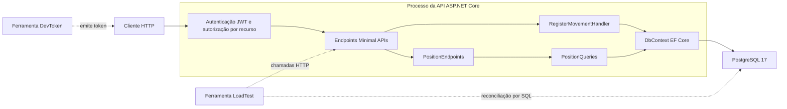
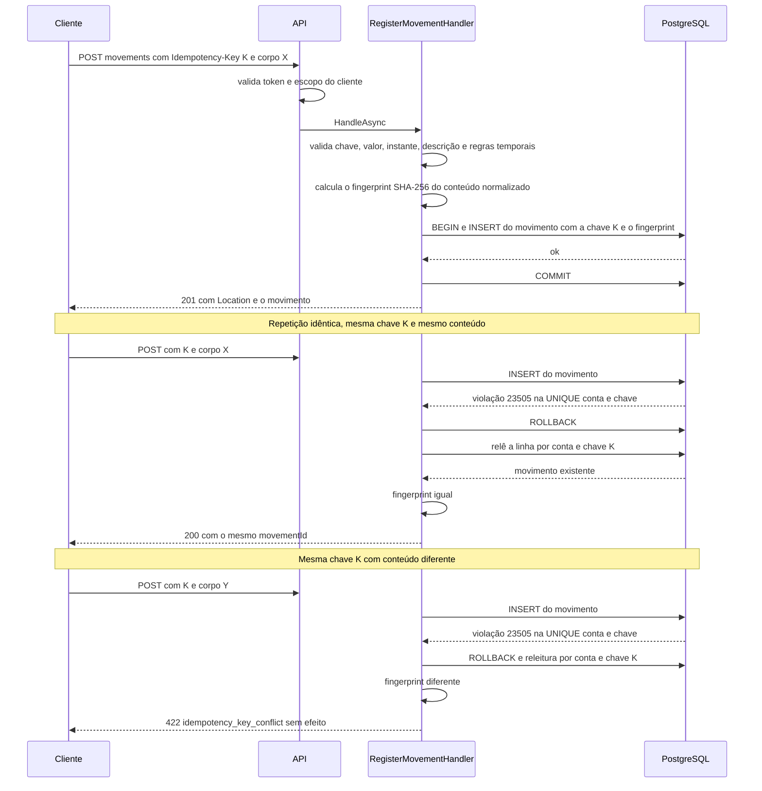
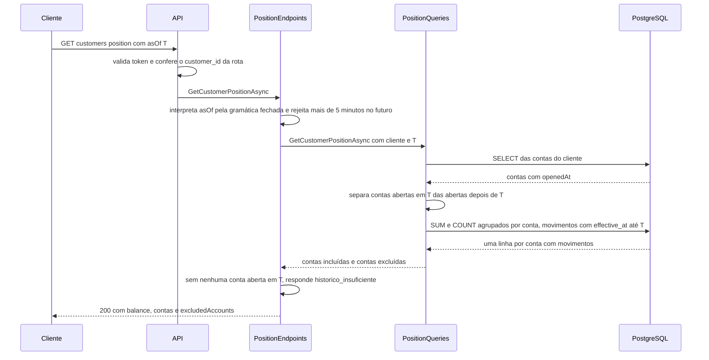

# Arquitetura

Este documento descreve o que está implementado em `FinancialTransactions` e por que foi desenhado assim. As hipóteses de negócio (H1 a H14) estão em [escopo.md](escopo.md); a correspondência requisito → código → teste e os resultados datados estão em [verificacao.md](verificacao.md); o ensaio de carga está em [carga.md](carga.md). A única seção que fala de coisas **não implementadas** é a última, [Evoluções e o que faria diferente com mais tempo](#evoluções-e-o-que-faria-diferente-com-mais-tempo).

## Visão

O sistema é um **registro de movimentações financeiras** (créditos e débitos em contas de clientes) com consulta de **posição derivada**: o saldo de uma conta ou de um cliente em um instante `asOf`, calculado a partir dos movimentos com `effectiveAt <= asOf`.

O que ele **não** é:

- não autoriza operações nem limita saldo: um débito é registrado mesmo que deixe o saldo negativo, porque o fato já ocorreu (H1);
- não corrige nem estorna movimentos: não há atualização nem exclusão de movimentos pela API;
- não gerencia cadastros: clientes e contas são semeados pela migration (H2);
- não publica eventos nem tem fila, cache ou posição materializada (H12).

## Componentes e fronteiras

A API é um único processo. `DevToken` e `LoadTest` são ferramentas de console separadas: não fazem parte da API e não são referenciadas por ela.

| Projeto | Responsabilidade | Depende de |
|---|---|---|
| `src/FinancialTransactions.Domain` | Tipos e regras puros: `Movement`, `MovementAmount`, `MovementRules`, `IdempotencyKey` (validação e fingerprint), `InstantParser`, `Account`, `Customer`. Sem I/O. | nada além da biblioteca base |
| `src/FinancialTransactions.Infrastructure` | Persistência: `FinancialTransactionsDbContext`, configurações snake_case, migration `InitialSchema` com seed, `MovementAmountConverter`, `PositionQueries` (SUM e COUNT no banco). | Domain, EF Core, Npgsql |
| `src/FinancialTransactions.Api` | Transporte e orquestração: Minimal APIs, JWT, autorização por recurso (`AccountAccess`), `ProblemDetails`, `RegisterMovementHandler`, health checks, limite de corpo, logs. | Infrastructure (e, por ela, Domain) |
| `tools/FinancialTransactions.DevToken` | Emite um JWT local de desenvolvimento. | pacote de JWT |
| `tools/FinancialTransactions.LoadTest` | Ensaio de carga e reconciliação. Conversa com a API por HTTP e com o banco por SQL. | pacotes de JWT e Npgsql |
| `tests/` | Unidade (xUnit) e integração (xUnit, host real da API e PostgreSQL real). | Domain, Infrastructure, Api |

### Onde cada coisa está

O código está organizado assim, e o desenho acima o reflete:

- **Escrita:** `Api/Endpoints/MovementEndpoints.cs` é a fronteira HTTP e chama `Api/Movements/RegisterMovementHandler.cs`, o caso de uso. O handler recebe pelo construtor o `FinancialTransactionsDbContext` de Infrastructure, o `AccountAccess`, um `TimeProvider` e o `IRegisterMovementFailurePoints` (ponto de injeção de falha dos testes; em produção só existe `NoFailurePoints`). Os contratos e o parsing da requisição ficam em `Api/Movements/MovementContracts.cs`.
- **Leitura:** `Api/Endpoints/PositionEndpoints.cs` é a fronteira HTTP **e** orquestra a leitura (autorização, validação de `asOf`, regras de história insuficiente). Ele recebe `PositionQueries` e `TimeProvider` por parâmetro. `Infrastructure/PositionQueries.cs` faz a seleção de contas e a agregação em SQL pelo `DbContext`. Os contratos de resposta ficam em `Api/Positions/PositionContracts.cs`.
- **Domínio:** `Domain/` não conhece HTTP nem EF Core.

### O que separa e o que não separa

Separa: **domínio puro** (regras de valor, tempo e idempotência, testáveis sem banco), **persistência** (mapeamento, migration, consulta de posição) e **transporte** (HTTP, autenticação, mapeamento de erros).

Não separa: **não existe camada de aplicação própria nem portas e adaptadores**. O handler de escrita e os endpoints de leitura vivem no projeto `Api` e dependem diretamente do `DbContext` concreto; `PositionQueries` também usa o `DbContext` diretamente. Não é Clean Architecture, Hexagonal nem outro estilo formal, e o texto não alega isso. A razão é o tamanho do recorte: dois casos de uso, um banco, um processo. Uma camada de portas e adaptadores aqui acrescentaria interfaces com uma única implementação e nenhuma segunda fronteira para testar; os testes de integração exercem o caminho real contra PostgreSQL. Se o sistema ganhasse um segundo adaptador de entrada (por exemplo, consumidor de mensagens) ou de saída, a separação passaria a pagar o seu custo.

## Fluxos

### Registro de movimento, com repetição

A identidade da intenção `(conta, chave)` e o fingerprint do conteúdo ficam **na própria linha do movimento**. A UNIQUE `ux_movements_account_id_idempotency_key` decide a corrida: de várias requisições simultâneas com a mesma chave, o PostgreSQL deixa uma só inserir; as outras recebem `23505` exatamente nessa constraint, revertem e releem a linha vencedora. O filtro é por **nome da constraint**: outra violação única é falha inesperada (500), não repetição. Se a releitura não achar linha (estado inesperado), a resposta é `409 retry_later`, sem repetir o insert.

### Posição do cliente em um instante

O saldo **nunca** é somado em memória a partir de movimentos: o banco devolve uma linha agregada por conta, e a API soma essas parcelas. Conta aberta em `T` e sem movimentos até `T` tem saldo zero (a origem é conhecida); conta aberta depois de `T` não entra na soma e aparece em `excludedAccounts`; se nenhuma conta estava aberta, a resposta é `422 historico_insuficiente`, nunca zero (H6, H7).

## Modelo e invariantes

| Tabela | Colunas essenciais |
|---|---|
| `customers` | `id` (PK), `name`, `created_at` |
| `accounts` | `id` (PK), `customer_id` (FK), `currency` (`char(3)`), `opened_at` (`timestamptz`) |
| `movements` | `id` (PK), `account_id` (FK), `type` (`smallint`), `amount` (`numeric(18,2)`), `currency`, `effective_at` e `registered_at` (`timestamptz`), `idempotency_key` (`varchar(128)`), `request_fingerprint` (`char(64)`), `description` (`varchar(140)`, anulável) |

Índices de `movements`: `pk_movements`, `ux_movements_account_id_idempotency_key` (UNIQUE `(account_id, idempotency_key)`) e `ix_movements_account_id_effective_at` (`(account_id, effective_at)`).

**O banco garante:** a UNIQUE de idempotência; as chaves estrangeiras; colunas obrigatórias (`NOT NULL`); `CHECK (amount > 0)` (`ck_movements_amount_positive`); `numeric(18,2)` como **armazenamento** em escala 2.

**O domínio garante, antes de chegar ao banco:** `MovementAmount` (positivo, **no máximo duas casas decimais, rejeitando excesso em vez de arredondar**, teto de 1.000.000.000,00); as regras temporais (`effectiveAt` não anterior à abertura da conta e não mais de 5 minutos no futuro; `asOf` não mais de 5 minutos no futuro); a normalização dos instantes para UTC com precisão de microssegundos; o fingerprint (SHA-256 sobre tipo, valor, instante normalizado e descrição); a gramática fechada de instantes (`InstantParser`).

Uma observação para não superestimar o banco: a coluna `numeric(18,2)` **não** rejeita um valor com mais casas, o PostgreSQL o arredondaria na coerção. Quem rejeita é o domínio, e por isso a rejeição precisa acontecer antes da gravação.

## Decisões

Cada decisão cita onde está no código e o que a verifica. Os nomes de teste são o `DisplayName` (quando existe) seguido do método C#, como aparecem no relatório de testes; a tabela completa está em [verificacao.md](verificacao.md).

### ADR-1 · Serviço único, sem broker, cache nem Outbox (H12)

- **Contexto:** o recorte é um sistema de registro com uma consulta derivada, num único banco.
- **Decisão:** uma API ASP.NET Core com EF Core e PostgreSQL. Sem mensageria, cache, Outbox ou microsserviços.
- **Alternativas:** publicar eventos via Outbox; cache de posição; separar leitura e escrita em serviços.
- **Consequências:** o sistema inteiro é verificável com um banco e um processo; não há consumidores, então não há o que notificar. Não há tolerância a falha do banco além do `503` (ADR-6).
- **Revisão:** se surgir um consumidor externo dos movimentos, ou se a leitura passar a dominar a carga (ver ADR-2).
- **Onde:** `src/FinancialTransactions.Api/Program.cs`. **Verificação:** o ensaio de carga ([carga.md](carga.md)) e toda a suíte de integração rodam esse desenho contra PostgreSQL real; `Composition_ProductionHost_ResolvesNoFailurePoints` (`CompositionProductionHostResolvesNoFailurePoints`) confere que o host de produção não carrega pontos de falha.

### ADR-2 · Posição por SUM no banco, sem saldo materializado

- **Contexto:** a posição é pedida em instantes arbitrários (`asOf`), inclusive passados, e movimentos com `effectiveAt` antigo podem chegar depois (H9).
- **Decisão:** calcular `SUM` e `COUNT` no banco a cada consulta, com SQL parametrizado (`SqlQueryRaw`), sobre `movements` filtrados por conta e `effective_at <= asOf`.
- **Alternativas:** saldo materializado por conta; cache por `asOf`; reconstruir em memória.
- **Consequências:** o saldo é sempre coerente com os movimentos, inclusive depois de informação tardia; nenhuma invalidação. O custo da consulta cresce com os movimentos da conta até `asOf`.
- **Revisão** (condição registrada em [carga.md](carga.md)): volume de movimentos por conta ordens de grandeza acima do ensaiado (250 a 343 por conta), p95 do GET de posição acima de 250 ms em carga representativa, ou leituras dominando a carga.
- **Onde:** `src/FinancialTransactions.Infrastructure/PositionQueries.cs`. **Verificação:** `PositionQuery_AggregatesInDatabase` (`PositionQueryAggregatesInDatabase`), `T12_HundredCents_SumExactlyOneReal`, `T02_TwoHistoricalCuts_ReturnDifferentBalances`, `T04_LateInformation_ChangesHistoricalPositions`; ensaio de carga e planos de consulta em [carga.md](carga.md).

### ADR-3 · Idempotência na própria linha, não numa tabela de requisições

- **Contexto:** repetições (inclusive simultâneas) da mesma intenção não podem criar dois movimentos.
- **Decisão:** a chave de idempotência e o fingerprint do conteúdo são colunas do movimento, sob UNIQUE `(account_id, idempotency_key)`. Insere-se e trata-se a violação `23505` dessa constraint; relê-se e compara-se o fingerprint.
- **Alternativas:** tabela separada de requisições processadas (com seu ciclo de vida e limpeza); verificação prévia com `SELECT` antes do `INSERT` (sujeita a corrida); lock explícito por chave.
- **Consequências:** a garantia é do banco, não de código de aplicação; não há segunda tabela para manter consistente com a primeira. O replay devolve o movimento original. O fingerprint inclui `description`, que **não** consta na resposta; portanto a resposta sozinha não permite reconstruir um replay de uma requisição que tinha descrição.
- **Revisão:** se for preciso guardar a resposta original exata, ou expirar chaves (hoje sem expiração, fora de escopo).
- **Onde:** `src/FinancialTransactions.Api/Movements/RegisterMovementHandler.cs` (`HandleAsync`, `IsIdempotencyConflict`), `Infrastructure/Configurations/MovementConfiguration.cs`, `Domain/IdempotencyKey.cs`. **Verificação:** `T05_SameKeySameBody_ReplaysSameMovement`, `T05b_SameKeyDifferentBody_IsConflict_NoEffect`, `T06_SameKeySameBody_Concurrent_OneCreatedRestReplayed`, `T06b_SameKeyDifferentBodies_Concurrent_OneCreatedRestConflict`, `T07b_DistinctKeysSameContent_AreTwoLegitimateMovements`, `Fingerprint_ReplayWithSixDigitsReturnedBy201_Is200`, e, na unidade, `IsIdempotencyConflict_TrueOnlyForIdempotencyConstraint` e `IsIdempotencyConflict_FalseForPrimaryKeyViolation`.

### ADR-4 · Instantes: `effectiveAt` com offset, `asOf` com gramática fechada, UTC na resposta, fronteira inclusiva

- **Contexto:** interpretação de data e hora pelo fuso da máquina ou por cultura regional produziria resultados diferentes entre ambientes.
- **Decisão:** `effectiveAt` (POST) exige data e hora completas com `Z` ou `±HH:mm`; `asOf` (GET) aceita o mesmo e, **adicionalmente**, data e hora completas sem offset, lidas como UTC. Tudo por lista fechada de formatos e cultura invariante (`InstantParser`), nunca `TryParse` genérico. As respostas devolvem sempre UTC. A fronteira é inclusiva: a posição em `asOf` conta movimentos com `effectiveAt <= asOf`.
- **Alternativas:** aceitar qualquer formato reconhecido pelo .NET; assumir o fuso do servidor; fronteira exclusiva.
- **Consequências:** o mesmo instante em offsets diferentes é o mesmo movimento e a mesma posição; entradas ambíguas são recusadas com `422 validation_error`. O offset original não é preservado. Em query string, um `+` precisa ser codificado como `%2B`.
- **Revisão:** se clientes precisarem de eco do offset original.
- **Onde:** `src/FinancialTransactions.Domain/InstantParser.cs`, `Domain/Movement.cs` (normalização), `Api/Positions/PositionContracts.cs` (`AsOfParser`). **Verificação:** `F1a_PostEffectiveAtWithoutOffset_Is422_NothingPersisted`, `F1b_PostEffectiveAtNumber_Is422`, `F1c_PostZAndOffsetSameInstant_ReplayAcrossRepresentations`, `F1d_GetAsOfHourOnly_DateOnly_Regional_Text_Are422`, `F1e_GetAsOfCompleteWithoutOffset_IsUtc`, `T02b_SameInstantDifferentOffset_SameBalance`, e os testes de unidade de `InstantParserTests`.

### ADR-5 · JWT HS256 local com `customer_id` e 404 para fora do escopo

- **Contexto:** o recorte precisa proteger o acesso por cliente sem um provedor de identidade externo.
- **Decisão:** JWT HS256 com emissor e audiência fixos (`financialtransactions-dev`, `financialtransactions-api`), assinado por uma chave simétrica de pelo menos 32 bytes fornecida por variável de ambiente ou user-secrets (nunca em arquivo versionado); a claim `customer_id` define o escopo. A autorização é **por recurso**: conta ou cliente de outro escopo, ou inexistente, responde `404`, sem revelar existência, inclusive na repetição de um POST. Token sem `customer_id` válido é `401`.
- **Alternativas:** provedor de identidade real (OIDC); chave assimétrica com JWKS; `403` para fora do escopo.
- **Consequências:** simples de reproduzir localmente; o emissor é uma ferramenta de desenvolvimento (`DevToken`), não um serviço de identidade. A chave simétrica é compartilhada entre quem emite e quem valida.
- **Revisão:** qualquer uso fora de laboratório (rotação de chave, emissor real).
- **Onde:** `src/FinancialTransactions.Api/Program.cs`, `Api/Auth/` (`AccountAccess`, `CustomerScope`, `AuthDefaults`). **Verificação:** `T11_NoToken_Is401`, `T11b_OtherCustomer_Is404_EvenOnReplay`, `T11c_InvalidTokens_Are401_NothingPersisted`, `T11c_ControlToken_IsAccepted`, `T12_Selection_OtherAccountAndOtherCustomerDoNotLeak`.

### ADR-6 · `503` classificado em vez de retry automático

- **Contexto:** com o banco indisponível, responder `200` com saldo zero seria falso, e um `201` sem commit seria perda silenciosa.
- **Decisão:** falhas de disponibilidade (exceção transitória do Npgsql, `TimeoutException`, `SocketException`, na exceção ou em uma `InnerException`) viram `503 dependency_unavailable` em `ProblemDetails`, com `traceId` e sem detalhes da exceção, em prazo limitado por `Timeout=5;Command Timeout=15` na connection string. Violações de constraint e demais falhas continuam `500`. A API **não** repete POST sozinha: o cliente repete com a mesma `Idempotency-Key`.
- **Alternativas:** retry automático no servidor; circuit breaker; resposta degradada.
- **Consequências:** a decisão de repetir é do cliente, e a idempotência torna a repetição segura: se a tentativa que recebeu `503` não chegou ao commit, a repetição cria; se chegou, devolve `200` com o mesmo movimento.
- **Revisão:** se houver necessidade de absorver quedas curtas sem o cliente perceber.
- **Onde:** `src/FinancialTransactions.Api/Http/ApiExceptionHandler.cs` (`IsDependencyUnavailable`). **Verificação:** `T13a_PostWhenDatabaseUnreachable_Is503_WithinDeadline`, `T13b_GetPositionWhenDatabaseUnreachable_Is503_NotZero`, os cinco testes de unidade `IsDependencyUnavailable_*`, e a sondagem de reinício do PostgreSQL contra a API real ([verificacao.md](verificacao.md)).

### ADR-7 · Limite de corpo e health checks sem detalhe

- **Contexto:** a entrada tem um único campo livre (`description`, até 140 caracteres); orquestradores precisam sondar a saúde sem credencial.
- **Decisão:** corpos acima de 16 KB em `/api/v1` são recusados com `413 payload_too_large` (por `Content-Length` antes de ler, e pelo limite do servidor quando não há `Content-Length`). `/health/live` (não toca o banco) e `/health/ready` (`SELECT 1` em até 3 s) são **anônimos** e devolvem só `{"status":"Healthy"}` ou `{"status":"Unhealthy"}`, sem nome de dependência, mensagem de exceção ou connection string. As rotas financeiras continuam exigindo token.
- **Alternativas:** limite apenas no servidor (valeria também para as sondas); sondas autenticadas; corpo detalhado nas sondas.
- **Consequências:** o limite vale só para o grupo financeiro e é exercido pelo mesmo código nos testes; as sondas não vazam informação de ambiente.
- **Revisão:** se as sondas passarem a ser expostas fora de uma rede de confiança.
- **Onde:** `src/FinancialTransactions.Api/Http/RequestBodyLimit.cs`, `Api/Health/`. **Verificação:** `RequestBody_Over16KB_Is413_NothingPersisted` (camada de `Content-Length`; a camada do servidor foi evidenciada pela sondagem contra Kestrel real), `Health_IsAnonymous_ApiIsNot`, `T13c_ReadyIs503_LiveIs200_WhenDatabaseUnreachable`, `T13d_ReadyIs200_WhenDatabaseAvailable`.

### ADR-8 · `TreatWarningsAsErrors` com análise `latest-recommended`

- **Contexto:** a entrega exige compilar sem erros e sem avisos.
- **Decisão:** `Directory.Build.props` fixa `TreatWarningsAsErrors=true`, `EnforceCodeStyleInBuild=true` e `AnalysisLevel=latest-recommended` para todos os projetos (inclusive ferramentas e testes). O portão é o código de saída de `dotnet build -warnaserror`, não a leitura do resumo.
- **Alternativas:** avisos tolerados com revisão manual; análise mais branda.
- **Consequências:** qualquer aviso de compilador ou analisador interrompe o build; o ruído é pago uma vez, na escrita.
- **Revisão:** se uma atualização do SDK introduzir diagnósticos que exijam supressão; supressões não são usadas.
- **Onde:** `Directory.Build.props`. **Verificação:** restore e build `-warnaserror` com código de saída 0 em todos os ciclos e na CI ([verificacao.md](verificacao.md)).

### ADR-9 · Índices atuais, sem índice novo (P04)

- **Contexto:** o ensaio de carga e a análise de planos mediram se a posição precisava de mais índices.
- **Decisão:** manter `pk_movements`, `ux_movements_account_id_idempotency_key` e `ix_movements_account_id_effective_at`. Nenhum índice novo, nenhuma mudança em `PositionQueries`.
- **Alternativas:** índice de cobertura incluindo `type` e `amount`; particionamento.
- **Consequências:** com 125 mil movimentos, a consulta indexada custou décimos de milissegundo; sem o índice dedicado, o planejador usa o índice único pela primeira coluna e filtra o restante; sem nenhum índice iniciado por `account_id`, há varredura sequencial (ordens de grandeza mais lenta).
- **Revisão:** mesma condição do ADR-2; avaliar primeiro um índice de cobertura e só depois uma posição derivada.
- **Onde:** `Infrastructure/Configurations/MovementConfiguration.cs`. **Verificação:** ensaio de carga e planos (`EXPLAIN`) em [carga.md](carga.md), seção "Planos das consultas".

## Segurança e dados

Proporcional ao desenho; nenhuma conformidade regulatória é alegada.

**O que protege:**

- token por cliente (`customer_id`) e autorização por recurso, com `404` fora do escopo (ADR-5);
- logs **da aplicação** sem corpo, `Authorization`, `Idempotency-Key` bruta, connection string nem chave: o registro de um movimento gera `MovementRegistered` com identificadores, a indisponibilidade gera `DependencyUnavailable` com método, rota e `traceId`; um teste de integração captura os logs de um POST, uma repetição, um `422` e um `401` e procura esses valores (`Logs_DoNotContainSecretsOrBodies`);
- chave de assinatura fora do repositório (variável de ambiente ou user-secrets);
- dados do repositório e do ensaio **sintéticos**; a credencial do banco `ft_local_dev_only` é de laboratório e está em arquivos versionados de propósito (composição Docker, configuração de desenvolvimento, documentação e workflow de CI);
- respostas de erro sem detalhes internos; sondas de saúde sem informação de ambiente;
- limite de corpo de 16 KB.

**O que não há:**

- criptografia em repouso própria: o volume do PostgreSQL é o do container, sem camada adicional;
- rotação de chave, JWKS ou emissor de identidade real: o emissor é uma ferramenta de desenvolvimento;
- auditoria de acesso (quem consultou o quê);
- política de retenção ou expiração: os dados ficam até remoção manual;
- limitação de taxa.

**Limites do que foi verificado sobre logs:** o teste cobre os logs da aplicação, não os do PostgreSQL, do executor de CI nem de qualquer infraestrutura. `description` é texto livre do cliente: a aplicação não o registra em log, mas, em uso real, ele pode conter o que o cliente enviar.

## Evoluções e o que faria diferente com mais tempo

Nada desta seção está implementado. São propostas, cada uma com o que ganha, o que custa e o que a tornaria desnecessária; não constam como funcionalidade no README nem em [verificacao.md](verificacao.md).

1. **Bitemporalidade (eixo de conhecimento).** Hoje a posição histórica reflete o conhecimento atual (H9). Para responder "qual era a posição em T segundo o que se sabia em T2", seria preciso um segundo eixo temporal.
   - *Ganha:* auditoria e conciliação reproduzíveis no tempo.
   - *Custa:* modelagem e consultas mais complexas. **Ressalva:** `registeredAt` é o instante em que o servidor montou o registro, não o instante do commit nem o da visibilidade para outras transações, e não garante completude; filtrar por essa coluna **não basta**. O eixo de conhecimento precisaria de uma semântica de confirmação própria.
   - *Deixa de ser necessário se:* nenhum consumidor precisar reproduzir o que o sistema sabia em um instante.
2. **Fluxo de correção e estorno com identidade preservada.** Hoje não há correção: o movimento original nunca muda (T14 é parcial).
   - *Ganha:* corrigir erros sem apagar história, com rastro do vínculo entre o movimento e o seu estorno.
   - *Custa:* novos tipos de movimento, regras de elegibilidade e testes de concorrência sobre o mesmo alvo.
   - *Deixa de ser necessário se:* o negócio tratar correções fora deste sistema.
3. **Relógio controlável na fixture de testes.** O `TimeProvider` já é injetado na aplicação (`TimeProvider.System`); o que falta é a fixture substituí-lo por um relógio congelável.
   - *Ganha:* testar as janelas de 5 minutos e a fronteira de `asOf` sem depender do relógio real.
   - *Custa:* trocar o registro no host de teste e ajustar os testes existentes.
   - *Deixa de ser necessário se:* as regras de janela forem cobertas só em unidade (`MovementRulesTests` já as cobre com `now` explícito).
4. **Publicação de eventos com Outbox.** *Ganha:* notificar consumidores sem perder eventos nem duplicar sob falha. *Custa:* tabela de Outbox, processo de despacho, idempotência no consumidor. *Deixa de ser necessário se:* não existir consumidor (situação atual, H12).
5. **Posição derivada com reconciliação.** Se o volume de movimentos por conta crescer por ordens de grandeza (condição em [carga.md](carga.md)), manter um saldo derivado atualizado e uma reconciliação periódica contra a soma dos movimentos. *Ganha:* leitura em tempo constante. *Custa:* coerência a provar, reprocessamento. *Deixa de ser necessário se:* a consulta indexada continuar dentro da meta.
6. **Observabilidade com OpenTelemetry.** *Ganha:* traços e métricas por requisição, em vez de logs soltos. *Custa:* coletor e disciplina de atributos sem dados sensíveis. *Deixa de ser necessário se:* a operação se resumir a um ambiente de laboratório.
7. **Rotação de chave, JWKS e emissor real.** *Ganha:* identidade de produção, chaves sem segredo compartilhado. *Custa:* dependência de um provedor de identidade. *Deixa de ser necessário se:* o serviço ficar restrito a laboratório.
8. **Limitação de taxa.** *Ganha:* proteção contra abuso e contra saturação por um cliente. *Custa:* política de limites e estado compartilhado entre instâncias. *Deixa de ser necessário se:* houver um gateway que já a aplique.
9. **Abertura de contas e clientes por API.** *Ganha:* cadastro sem migration. *Custa:* novas regras (titularidade, abertura) e autorização administrativa. *Deixa de ser necessário se:* o cadastro vier de outro sistema.
10. **Testes de contrato.** *Ganha:* garantir que clientes não quebram quando a API muda. *Custa:* manutenção do contrato versionado. *Deixa de ser necessário se:* houver um único cliente, mantido junto da API.
11. **Controles negativos do reconciliador.** A reconciliação do ensaio de carga não encontrou divergências, mas ninguém adulterou deliberadamente o banco para provar que ela as detectaria. *Ganha:* confiança na capacidade de detecção. *Custa:* um ensaio a mais, com alteração controlada de dados num banco descartável. *Deixa de ser necessário se:* a reconciliação passar a ser coberta por testes automatizados de adulteração.
