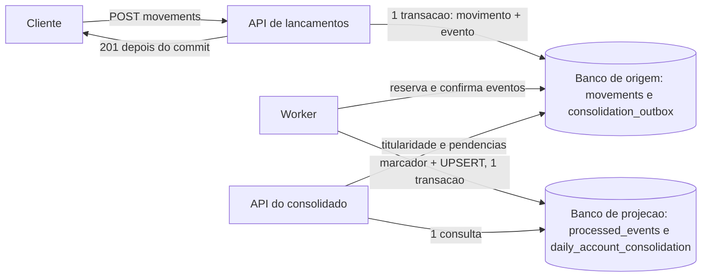

# Demonstração: independência da escrita, falha da consolidação, recuperação e 50 req/s

Este documento responde, com links para o código, um teste executado e resultados medidos, a quatro perguntas sobre a solução:

| # | Pergunta | Onde está a resposta |
|---|---|---|
| 1 | Em que ponto do código a escrita de lançamentos deixa de depender da consolidação? | [Seção 1](#1-onde-está-a-independência) |
| 2 | Com a consolidação parada, os lançamentos continuam sendo aceitos e persistidos? | [Seção 2](#2-teste-executado-consolidação-interrompida-com-novos-lançamentos) |
| 3 | Como o consolidado se recupera e volta a refletir os saldos depois da falha? | [Seção 3](#3-recuperação-sobre-a-execução-observada) |
| 4 | Quais foram os resultados medidos a 50 consultas por segundo e qual a perda? | [Seção 4](#4-resultados-de-50-reqs-com-perda-máxima-de-5) |

**Versão demonstrada.** Todos os links de código apontam para o commit [`48a08a0`](https://github.com/antonio-leonardo/FinancialTransactions/tree/48a08a05653c52f69465e2ab5e000ba8ba7bf962) e as linhas foram conferidas lendo cada arquivo nesse commit. O código de produto (`src/`) não foi alterado para esta demonstração; o que foi acrescentado é o script [`scripts/Demonstracao-Independencia.ps1`](../scripts/Demonstracao-Independencia.ps1), este documento e os resultados em [`docs/demonstracao/`](demonstracao/). **Fonte dos resultados:** execução do executor em 21/10/2026 (horários em UTC nas tabelas), numa máquina de desenvolvimento única. Reprodução por terceiros: ver a coluna de estado em [verificacao.md](verificacao.md), seção 0. Como reproduzir tudo: [seção 5](#5-como-reproduzir).

## 1. Onde está a independência

**Em uma frase.** Registrar um lançamento grava, **na mesma transação do banco de origem**, o movimento e um evento numa tabela de trabalho (a Outbox); o cliente só recebe `201` depois do commit; a consolidação diária é outro processo (Worker) que lê essa Outbox, soma numa projeção em **outro banco** e a API do consolidado lê a projeção. A API de lançamentos não referencia, não configura e não consulta nada da projeção.



### 1.1 Caminho de escrita

| Arquivo e linhas | Símbolo | O que faz |
|---|---|---|
| [MovementEndpoints.cs:L18](https://github.com/antonio-leonardo/FinancialTransactions/blob/48a08a05653c52f69465e2ab5e000ba8ba7bf962/src/FinancialTransactions.Api/Endpoints/MovementEndpoints.cs#L18) e [MovementEndpoints.cs:L23-L46](https://github.com/antonio-leonardo/FinancialTransactions/blob/48a08a05653c52f69465e2ab5e000ba8ba7bf962/src/FinancialTransactions.Api/Endpoints/MovementEndpoints.cs#L23-L46) | `MapMovementEndpoints`, `RegisterAsync` | Rota `POST /api/v1/accounts/{accountId}/movements`; chama o caso de uso e só traduz o resultado em HTTP (`Created` vira `201` com `Location`; repetição vira `200`). |
| [RegisterMovementHandler.cs:L37-L97](https://github.com/antonio-leonardo/FinancialTransactions/blob/48a08a05653c52f69465e2ab5e000ba8ba7bf962/src/FinancialTransactions.Api/Movements/RegisterMovementHandler.cs#L37-L97) | `RegisterMovementHandler.HandleAsync` (validação) | Cabeçalho de idempotência, corpo, conta autorizada e regras de tempo: tudo é decidido **antes** de gravar. Nada aqui toca a projeção. |
| [RegisterMovementHandler.cs:L104-L117](https://github.com/antonio-leonardo/FinancialTransactions/blob/48a08a05653c52f69465e2ab5e000ba8ba7bf962/src/FinancialTransactions.Api/Movements/RegisterMovementHandler.cs#L104-L117) | `HandleAsync` (transação única) | `BeginTransactionAsync` (L104); o movimento (L106) e o evento da Outbox (L109) entram no **mesmo** `SaveChangesAsync` (L112); `CommitAsync` (L114); **só depois** `RegisterMovementResult.Created` (L117), que o endpoint transforma em `201`. |
| [RegisterMovementHandler.cs:L119-L146](https://github.com/antonio-leonardo/FinancialTransactions/blob/48a08a05653c52f69465e2ab5e000ba8ba7bf962/src/FinancialTransactions.Api/Movements/RegisterMovementHandler.cs#L119-L146) | `HandleAsync` (repetição) | Violação única da chave de idempotência (`23505`) reverte a transação inteira (movimento **e** evento); a releitura acontece fora dela e devolve `200` com o mesmo movimento, ou `422` se o conteúdo diferir. Repetição e falha antes do commit não geram evento. |
| [RegisterMovementHandler.cs:L152-L160](https://github.com/antonio-leonardo/FinancialTransactions/blob/48a08a05653c52f69465e2ab5e000ba8ba7bf962/src/FinancialTransactions.Api/Movements/RegisterMovementHandler.cs#L152-L160) | `IsIdempotencyConflict` | Só a violação da constraint de idempotência conta como repetição. |
| [OutboxEvent.cs:L87-L99](https://github.com/antonio-leonardo/FinancialTransactions/blob/48a08a05653c52f69465e2ab5e000ba8ba7bf962/src/FinancialTransactions.Domain/OutboxEvent.cs#L87-L99) | `OutboxEvent.ForMovement` | Cria o evento com o **mesmo id do movimento** (`EventId` = id do movimento; contrato em [OutboxEvent.cs:L26-L30](https://github.com/antonio-leonardo/FinancialTransactions/blob/48a08a05653c52f69465e2ab5e000ba8ba7bf962/src/FinancialTransactions.Domain/OutboxEvent.cs#L26-L30)). |
| [FinancialTransactionsDbContext.cs:L12](https://github.com/antonio-leonardo/FinancialTransactions/blob/48a08a05653c52f69465e2ab5e000ba8ba7bf962/src/FinancialTransactions.Infrastructure/FinancialTransactionsDbContext.cs#L12) | `FinancialTransactionsDbContext.OutboxEvents` | A Outbox é uma tabela do **banco de origem**, no mesmo `DbContext` do movimento. |
| [DependencyInjection.cs:L13-L20](https://github.com/antonio-leonardo/FinancialTransactions/blob/48a08a05653c52f69465e2ab5e000ba8ba7bf962/src/FinancialTransactions.Infrastructure/DependencyInjection.cs#L13-L20) | `AddFinancialTransactionsInfrastructure` | Registra um único `DbContext` (origem) e `PositionQueries`. Não há `DbContext`, cliente ou connection string da projeção. |
| [PositionEndpoints.cs:L25-L63](https://github.com/antonio-leonardo/FinancialTransactions/blob/48a08a05653c52f69465e2ab5e000ba8ba7bf962/src/FinancialTransactions.Api/Endpoints/PositionEndpoints.cs#L25-L63) e [PositionQueries.cs:L53-L56](https://github.com/antonio-leonardo/FinancialTransactions/blob/48a08a05653c52f69465e2ab5e000ba8ba7bf962/src/FinancialTransactions.Infrastructure/PositionQueries.cs#L53-L56) | `GetAccountPositionAsync` | Posição por instante (`asOf`): soma calculada **na origem** a cada consulta; não lê o consolidado. |

### 1.2 Caminho de consolidação

| Arquivo e linhas | Símbolo | O que faz |
|---|---|---|
| [OutboxConsolidationSource.cs:L54-L72](https://github.com/antonio-leonardo/FinancialTransactions/blob/48a08a05653c52f69465e2ab5e000ba8ba7bf962/src/FinancialTransactions.Consolidation/OutboxConsolidationSource.cs#L54-L72) e [OutboxConsolidationSource.cs:L100-L128](https://github.com/antonio-leonardo/FinancialTransactions/blob/48a08a05653c52f69465e2ab5e000ba8ba7bf962/src/FinancialTransactions.Consolidation/OutboxConsolidationSource.cs#L100-L128) | `AcquireSql`, `AcquireAsync` | Reserva **um** evento pendente na origem (`FOR UPDATE SKIP LOCKED`), gravando dono, token e vencimento de 45 s antes de tocar a projeção. |
| [OutboxConsolidationSource.cs:L74-L80](https://github.com/antonio-leonardo/FinancialTransactions/blob/48a08a05653c52f69465e2ab5e000ba8ba7bf962/src/FinancialTransactions.Consolidation/OutboxConsolidationSource.cs#L74-L80) e [OutboxConsolidationSource.cs:L130-L137](https://github.com/antonio-leonardo/FinancialTransactions/blob/48a08a05653c52f69465e2ab5e000ba8ba7bf962/src/FinancialTransactions.Consolidation/OutboxConsolidationSource.cs#L130-L137) | `ConfirmSql`, `ConfirmAsync` (a marcação de "processado") | Marca o evento como processado **depois** do commit da projeção; só vale com o token da reserva e a reserva ainda válida. |
| [ConsolidationConsumer.cs:L138-L187](https://github.com/antonio-leonardo/FinancialTransactions/blob/48a08a05653c52f69465e2ab5e000ba8ba7bf962/src/FinancialTransactions.Consolidation/ConsolidationConsumer.cs#L138-L187) | `ExecuteAsync` (laço), `Backoff` ([ConsolidationConsumer.cs:L75-L97](https://github.com/antonio-leonardo/FinancialTransactions/blob/48a08a05653c52f69465e2ab5e000ba8ba7bf962/src/FinancialTransactions.Consolidation/ConsolidationConsumer.cs#L75-L97)) | Laço do Worker: toda exceção de um ciclo é capturada, classificada e seguida de espera (backoff de 1 s a 30 s); o laço nunca propaga ao host. |
| [ConsolidationConsumer.cs:L389-L472](https://github.com/antonio-leonardo/FinancialTransactions/blob/48a08a05653c52f69465e2ab5e000ba8ba7bf962/src/FinancialTransactions.Consolidation/ConsolidationConsumer.cs#L389-L472) | `ProcessNextAsync` | Adquire, aplica e confirma um evento. Falha do evento conta tentativa; falha de infraestrutura libera a reserva e **não** conta tentativa; confirmação sem resposta não força nada. |
| [FailureClassifier.cs:L36-L89](https://github.com/antonio-leonardo/FinancialTransactions/blob/48a08a05653c52f69465e2ab5e000ba8ba7bf962/src/FinancialTransactions.Consolidation/FailureClassifier.cs#L36-L89) | `FailureClassifier.Classify` | Quatro classes: transitória, cancelamento do host, ambiente e evento. Só defeito do próprio evento chega à quarentena (cinco tentativas). |
| [DependencyFailure.cs:L15-L30](https://github.com/antonio-leonardo/FinancialTransactions/blob/48a08a05653c52f69465e2ab5e000ba8ba7bf962/src/FinancialTransactions.Infrastructure/DependencyFailure.cs#L15-L30) | `DependencyFailure.IsUnavailable` | Define "o banco não respondeu" (usado pelo Worker e pelas APIs). |
| [DailyConsolidationApplier.cs:L13-L31](https://github.com/antonio-leonardo/FinancialTransactions/blob/48a08a05653c52f69465e2ab5e000ba8ba7bf962/src/FinancialTransactions.Consolidation/DailyConsolidationApplier.cs#L13-L31) e [DailyConsolidationApplier.cs:L33-L75](https://github.com/antonio-leonardo/FinancialTransactions/blob/48a08a05653c52f69465e2ab5e000ba8ba7bf962/src/FinancialTransactions.Consolidation/DailyConsolidationApplier.cs#L33-L75) | `MarkerSql`, `UpsertSql`, `ApplyAsync` | **Uma transação no banco de projeção**: insere o marcador em `processed_events` e, só se ele for novo, soma no agregado do dia. Evento já aplicado não soma de novo. |
| [ConsolidationApiApp.cs:L17-L69](https://github.com/antonio-leonardo/FinancialTransactions/blob/48a08a05653c52f69465e2ab5e000ba8ba7bf962/src/FinancialTransactions.Consolidation.Api/ConsolidationApiApp.cs#L17-L69) | `ConsolidationApiApp.Create` | Composição da API do consolidado: processo próprio (porta 5110), strings de conexão para origem e projeção. |
| [DailyConsolidationService.cs:L11-L38](https://github.com/antonio-leonardo/FinancialTransactions/blob/48a08a05653c52f69465e2ab5e000ba8ba7bf962/src/FinancialTransactions.Consolidation.Api/DailyConsolidationService.cs#L11-L38) | `AccountOwnership` | A titularidade da conta é lida **na origem** (a API do consolidado depende da origem para autorizar). |
| [DailyConsolidationService.cs:L240-L281](https://github.com/antonio-leonardo/FinancialTransactions/blob/48a08a05653c52f69465e2ab5e000ba8ba7bf962/src/FinancialTransactions.Consolidation.Api/DailyConsolidationService.cs#L240-L281) | `ObserveAsync`, `Freshness` | Ordem obrigatória: primeiro a origem (pendências e instante `observedAt`), depois **uma** consulta à projeção. `complete`, `stale` ou `unknown` descrevem a pendência observada. |
| [ConsolidationQueries.cs:L18-L37](https://github.com/antonio-leonardo/FinancialTransactions/blob/48a08a05653c52f69465e2ab5e000ba8ba7bf962/src/FinancialTransactions.Consolidation/ConsolidationQueries.cs#L18-L37) e [ConsolidationQueries.cs:L58-L112](https://github.com/antonio-leonardo/FinancialTransactions/blob/48a08a05653c52f69465e2ab5e000ba8ba7bf962/src/FinancialTransactions.Consolidation/ConsolidationQueries.cs#L58-L112) | `UnresolvedEventsQuery`, `ConsolidationQueries` | Contagem de eventos não confirmados (origem) e consulta única à projeção. |
| [Problems.cs:L23-L24](https://github.com/antonio-leonardo/FinancialTransactions/blob/48a08a05653c52f69465e2ab5e000ba8ba7bf962/src/FinancialTransactions.Consolidation.Api/Problems.cs#L23-L24) | `Problems.DependencyUnavailable` | Projeção fora do ar vira `503 dependency_unavailable`, nunca saldo zero. |
| [ConsolidationHealth.cs:L87-L125](https://github.com/antonio-leonardo/FinancialTransactions/blob/48a08a05653c52f69465e2ab5e000ba8ba7bf962/src/FinancialTransactions.Consolidation/ConsolidationHealth.cs#L87-L125) e [DailyConsolidationEndpoints.cs:L22-L46](https://github.com/antonio-leonardo/FinancialTransactions/blob/48a08a05653c52f69465e2ab5e000ba8ba7bf962/src/FinancialTransactions.Consolidation.Api/DailyConsolidationEndpoints.cs#L22-L46) | `DatabasePing`, `WorkerReadinessCheck`, `ApiReadinessCheck` | Readiness do Worker e da API do consolidado: `SELECT 1` na origem **e** na projeção. A readiness da API de lançamentos não faz isso (ver 1.3). |
| [ConsolidationAdmin.cs:L61-L93](https://github.com/antonio-leonardo/FinancialTransactions/blob/48a08a05653c52f69465e2ab5e000ba8ba7bf962/src/FinancialTransactions.Consolidation/ConsolidationAdmin.cs#L61-L93) | `ConsolidationStatusReader` | `--status`: pendentes na Outbox, reservados, quarentena, fase e `processed_events`; dependência inalcançável é `unknown`, nunca zero. |

### 1.3 Dependências da escrita, verificadas uma a uma

Referência de compilação não é dependência operacional: o que conta é o caminho executado e os recursos exigidos. Cada verificação abaixo pode ser repetida com o comando indicado, que lê o commit `48a08a0` (`git grep ... 48a08a0 -- ...` não precisa de checkout).

| Verificação | Comando | Resultado |
|---|---|---|
| Referências de projeto da API de lançamentos | `git grep -n ProjectReference 48a08a0 -- 'src/FinancialTransactions.Api/*.csproj' 'src/FinancialTransactions.Infrastructure/*.csproj' 'src/FinancialTransactions.Auth/*.csproj' 'src/FinancialTransactions.Domain/*.csproj'` | A API referencia só `Auth` ([FinancialTransactions.Api.csproj:L9](https://github.com/antonio-leonardo/FinancialTransactions/blob/48a08a05653c52f69465e2ab5e000ba8ba7bf962/src/FinancialTransactions.Api/FinancialTransactions.Api.csproj#L9)) e `Infrastructure` ([FinancialTransactions.Api.csproj:L10](https://github.com/antonio-leonardo/FinancialTransactions/blob/48a08a05653c52f69465e2ab5e000ba8ba7bf962/src/FinancialTransactions.Api/FinancialTransactions.Api.csproj#L10)); `Infrastructure` referencia só `Domain`; `Auth` e `Domain` não referenciam projeto nenhum. Nenhum projeto de consolidação está no grafo. |
| Nada voltado à projeção na composição | `git grep -n -i -E 'consolida(tion\|ç)\|projection\|proje(ç\|c)ão\|HttpClient' 48a08a0 -- src/FinancialTransactions.Api` | Uma única ocorrência, um **comentário** em [RegisterMovementHandler.cs:L108](https://github.com/antonio-leonardo/FinancialTransactions/blob/48a08a05653c52f69465e2ab5e000ba8ba7bf962/src/FinancialTransactions.Api/Movements/RegisterMovementHandler.cs#L108). Nenhum serviço, `DbContext`, cliente HTTP ou health check voltado à projeção. A composição ([Program.cs:L18-L28](https://github.com/antonio-leonardo/FinancialTransactions/blob/48a08a05653c52f69465e2ab5e000ba8ba7bf962/src/FinancialTransactions.Api/Program.cs#L18-L28)) registra a infraestrutura da origem, relógio, `AccountAccess`, o handler, JWT e o health check `db`. |
| Readiness da escrita | `git grep -n -E 'GetConnectionString\|ConnectionStrings' 48a08a0 -- src/FinancialTransactions.Api src/FinancialTransactions.Infrastructure ':!*Migrations*'` | [DatabaseReadinessCheck.cs:L11-L36](https://github.com/antonio-leonardo/FinancialTransactions/blob/48a08a05653c52f69465e2ab5e000ba8ba7bf962/src/FinancialTransactions.Api/Health/DatabaseReadinessCheck.cs#L11-L36) abre a connection string `FinancialTransactions` e executa `SELECT 1` (prazo de 3 s); as únicas leituras de connection string na API são essa, a composição e as duas `appsettings`, todas da chave `FinancialTransactions`. |
| Configuração obrigatória | leitura de [Program.cs:L39-L47](https://github.com/antonio-leonardo/FinancialTransactions/blob/48a08a05653c52f69465e2ab5e000ba8ba7bf962/src/FinancialTransactions.Api/Program.cs#L39-L47) e [appsettings.json:L9-L11](https://github.com/antonio-leonardo/FinancialTransactions/blob/48a08a05653c52f69465e2ab5e000ba8ba7bf962/src/FinancialTransactions.Api/appsettings.json#L9-L11) | A API exige apenas a chave de assinatura JWT (mínimo de 32 bytes) e `ConnectionStrings:FinancialTransactions`. Não existe configuração da projeção. |
| Inicialização | `git grep -n -E 'Migrate\(\|MigrateAsync\|EnsureCreated\|IHostedService\|AddHostedService\|BackgroundService' 48a08a0 -- src/FinancialTransactions.Api src/FinancialTransactions.Infrastructure src/FinancialTransactions.Auth` | Nenhuma ocorrência: a API não aplica migration, não roda serviço de fundo e não consulta a projeção ao subir. |
| Binário compilado (mesmo código) | `Get-Content src/FinancialTransactions.Api/bin/Release/net10.0/FinancialTransactions.Api.deps.json` após `dotnet build -c Release` | O manifesto de dependências lista só `FinancialTransactions.Api`, `.Auth`, `.Domain` e `.Infrastructure`; a pasta de saída tem apenas essas DLLs do projeto. |
| Prova executada | [seção 2](#2-teste-executado-consolidação-interrompida-com-novos-lançamentos) | O script sobe a API de lançamentos **sem** `FT__ConnectionStrings__Consolidation` no ambiente e ela registra os lançamentos durante a falha. |

### 1.4 Fronteira declarada

- **Não derrubam a escrita:** queda do Worker, queda do banco de projeção, queda da API do consolidado. (Demonstrado na [seção 2](#2-teste-executado-consolidação-interrompida-com-novos-lançamentos) para os dois primeiros e nos testes C5 e C13 para o terceiro.)
- **Derrubam a escrita:** queda do banco de origem, do host ou falta de armazenamento para gravar o movimento e a Outbox. A origem saudável é pressuposto; alta disponibilidade é apenas uma proposta ([alta-disponibilidade.md](alta-disponibilidade.md)).
- **A API do consolidado depende da origem** para autorizar a conta e para contar as pendências ([DailyConsolidationService.cs:L11-L38](https://github.com/antonio-leonardo/FinancialTransactions/blob/48a08a05653c52f69465e2ab5e000ba8ba7bf962/src/FinancialTransactions.Consolidation.Api/DailyConsolidationService.cs#L11-L38)); sem a origem ela não responde.
- **Posição por instante** (`asOf`) é lida na origem a cada consulta; o **consolidado diário** é uma projeção materializada, eventualmente consistente, e diz o quanto (`freshness`).
- As duas leituras do consolidado (origem e projeção) são feitas em bancos diferentes: **não** formam um instantâneo atômico.

## 2. Teste executado: consolidação interrompida com novos lançamentos

### 2.1 O que o script faz

[`scripts/Demonstracao-Independencia.ps1`](../scripts/Demonstracao-Independencia.ps1) (PowerShell 7) sobe, em bancos descartáveis próprios, os três processos reais da solução (API de lançamentos em 5100, Worker em 5120, API do consolidado em 5110) e executa, num dos dois cenários:

| Etapa | O que acontece | O que prova |
|---|---|---|
| Antes | 6 lançamentos fixos pela própria API (A1 +100,00, A1 −30,00, A1 +20,00, A2 +50,00, A2 −8,00, B1 +10,00); coordenador `--backfill`; Worker e API do consolidado sobem; o script espera a fase `live` e `pending = 0`. | Estado inicial conhecido: `processed_events` = os 6 ids; consolidado `complete` com os valores que o **próprio script calculou** da sua lista. |
| Interrupção | `Workers`: o processo do Worker é encerrado. `Projection`: o container PostgreSQL **dedicado** da demonstração, que guarda a projeção, é parado (`docker stop`). | Sinais comprovados antes de qualquer lançamento da janela (processo terminado, porta fechada e `/health/live` sem resposta; ou `ready` do Worker e da API do consolidado em 503, consolidado em `503 dependency_unavailable` e o log do Worker com falha transitória e backoff, sem quarentena). |
| Durante | 10 lançamentos novos, um a um, por HTTP (A1 +40,00, A1 −15,00, A2 +25,00, B1 −3,00, A1 +12,50, A2 −5,50, B1 +60,00, A1 −7,25, A2 +9,99, B1 +1,01). | `10 de 10` com `201`; os 10 movimentos e as 10 linhas da Outbox (`status = 0`) existem **na origem**, conferidos por conjunto de ids; a projeção não contém nenhum deles (ou está inacessível, o que é registrado como "inacessível", não como zero); a posição por instante na origem (200) soma os lançamentos novos. |
| Retomada | Restaura **só o interrompido** (novo processo do Worker, ou `docker start` do container dedicado). Nada é recriado, limpo ou reconstruído. | Tempo medido, por polling de 500 ms e prazo de 120 s, até `pending = 0` **e** os 10 ids em `processed_events`. |
| Depois | Conjuntos e valores. Repetição de uma operação da janela. | `movements` = Outbox processada = `processed_events` = 16 ids, sem duplicados; valores por conta na origem = projeção = esperado do script; consolidado `complete`; repetição com a mesma chave devolve `200`, o mesmo `movementId`, nenhum movimento ou evento novo. |

Toda espera é por condição observável com prazo. Códigos de saída: `0` demonstração válida e aprovada; `10` algum critério reprovado (resultado preservado); `30` pré-condição não atendida ou execução inválida (grava `invalido.json`, nunca um resultado parcial). Recursos criados (bancos `ft_demo_<sufixo>_src` e `_cons`, processos por PID e, em `Projection`, o container `ft-demo-cons-<sufixo>`) são registrados antes de existir e removidos no `finally` pela lista exata. **Os containers do `docker-compose.yml` não são parados nem recriados**, e o script confere que continuam com os mesmos ids e `healthy`.

### 2.2 Por que a projeção do cenário `Projection` vive num container dedicado

A primeira ideia, tornar o banco da projeção indisponível com `ALTER DATABASE ... CONNECTION LIMIT 0` seguido de `pg_terminate_backend`, **não funciona neste ambiente**: o usuário `ft` das imagens `postgres` é superusuário, e superusuários são isentos do limite de conexões. Foi testado antes, num banco-sonda descartável: com `CONNECTION LIMIT 0` a conexão de `ft` seguiu aceita (`ALLOW_CONNECTIONS false` bloqueia, mas é outro mecanismo e não foi usado). Por isso o script cria um PostgreSQL próprio da demonstração (`docker run postgres:17`, porta 15439, nome `ft-demo-cons-<sufixo>`), guarda nele a projeção, o para e o religa; ao final ele é removido. A origem fica no container do `docker-compose.yml`, que nunca é tocado.

### 2.3 Resultados

Os dois cenários foram executados sobre `48a08a0`, cada um em bancos novos. Os resultados completos (critérios, lançamentos com início, fim, status, `movementId` e `Location`, consultas ao consolidado e linha do tempo) estão em [independencia-workers.md](demonstracao/independencia-workers.md) / [.json](demonstracao/independencia-workers.json) e [independencia-projecao.md](demonstracao/independencia-projecao.md) / [.json](demonstracao/independencia-projecao.json).

| Critério | `Workers` | `Projection` |
|---|---|---|
| Sinais da falha comprovados antes da janela | aprovado: processo terminado, porta 5120 fechada, `/health/live` sem resposta; readiness da escrita 200 | aprovado: `ready` do Worker e da API do consolidado 503; consolidado 503 `dependency_unavailable`; log do Worker com classe `Transient`; quarentena 0; readiness da escrita 200 |
| Escrita durante a falha | **10 de 10 com `201`** | **10 de 10 com `201`** |
| Persistência na origem durante a falha | 10 movimentos, 10 linhas na Outbox, 10 pendentes | 10 movimentos, 10 linhas na Outbox, 10 pendentes |
| Posição por instante na origem durante a falha | 200; A1 = 120,25 (esperado 120,25) | 200; A1 = 120,25 (esperado 120,25) |
| Projeção durante a falha | 0 dos 10 ids em `processed_events` | inacessível (consulta direta falhou; porta fechada) |
| Consolidado durante a falha | 200 `stale`, `unresolvedEvents`: A1 4, A2 3, B1 3, cliente A 7, cliente B 3 (valores ainda os de antes) | 503 `dependency_unavailable` nas 5 consultas |
| Convergência (da emissão da restauração até `pending = 0` e os 10 ids na projeção) | 3,47 s | 8,08 s |
| Reconciliação por conjuntos e valores | 16 = 16 = 16 ids, sem duplicados; valores origem = projeção = esperado | idem |
| Consolidado depois | 5 consultas `complete`, valores esperados (A1: créditos 172,50, débitos 52,25, líquido 120,25, 7 movimentos) | idem |
| Idempotência (repetir `demo-...-w-01`) | `200`, mesmo `movementId`, 16 movimentos e 16 eventos antes e depois, consolidado inalterado | idem |
| Containers do projeto | mesmos ids, `healthy` | mesmos ids, `healthy` |
| API de lançamentos | mesmo processo do começo ao fim (sem reinício) | idem |

**Leitura.** Em `Workers`, a API do consolidado continuou respondendo durante a falha, mas com `stale` e os valores de antes: o processamento estava interrompido, a leitura não. Em `Projection`, sem a projeção, o consolidado respondeu `503`: não há saldo para devolver, e a API não inventa um. Nos dois casos os 10 lançamentos foram aceitos com `201`, em 15 a 33 ms cada, e a posição por instante, lida na origem, já os refletia.

### 2.4 Testes automatizados correspondentes

O mesmo comportamento é exercitado nos testes de integração, com dois PostgreSQL reais ([`ConsolidationIndependenceTests.cs`](https://github.com/antonio-leonardo/FinancialTransactions/blob/48a08a05653c52f69465e2ab5e000ba8ba7bf962/tests/FinancialTransactions.IntegrationTests/ConsolidationIndependenceTests.cs)): [ConsolidationIndependenceTests.cs:L28](https://github.com/antonio-leonardo/FinancialTransactions/blob/48a08a05653c52f69465e2ab5e000ba8ba7bf962/tests/FinancialTransactions.IntegrationTests/ConsolidationIndependenceTests.cs#L28) (C1: Worker parado, lançamentos aceitos, consolidado `stale`), [ConsolidationIndependenceTests.cs:L63](https://github.com/antonio-leonardo/FinancialTransactions/blob/48a08a05653c52f69465e2ab5e000ba8ba7bf962/tests/FinancialTransactions.IntegrationTests/ConsolidationIndependenceTests.cs#L63) (C2: Worker novo aplica exatamente os 3 eventos e reconcilia), [ConsolidationIndependenceTests.cs:L106](https://github.com/antonio-leonardo/FinancialTransactions/blob/48a08a05653c52f69465e2ab5e000ba8ba7bf962/tests/FinancialTransactions.IntegrationTests/ConsolidationIndependenceTests.cs#L106) (C3: projeção inalcançável, escrita no ar, consolidado 503 em menos de 2 s), [ConsolidationIndependenceTests.cs:L145](https://github.com/antonio-leonardo/FinancialTransactions/blob/48a08a05653c52f69465e2ab5e000ba8ba7bf962/tests/FinancialTransactions.IntegrationTests/ConsolidationIndependenceTests.cs#L145) (C4: projeção volta depois de seis tentativas falhas, mesmo host se recupera sozinho), [ConsolidationIndependenceTests.cs:L186](https://github.com/antonio-leonardo/FinancialTransactions/blob/48a08a05653c52f69465e2ab5e000ba8ba7bf962/tests/FinancialTransactions.IntegrationTests/ConsolidationIndependenceTests.cs#L186) (C5: API do consolidado fora) e [ConsolidationIndependenceTests.cs:L209](https://github.com/antonio-leonardo/FinancialTransactions/blob/48a08a05653c52f69465e2ab5e000ba8ba7bf962/tests/FinancialTransactions.IntegrationTests/ConsolidationIndependenceTests.cs#L209) (C13: regressão da readiness da escrita). A diferença para este script é a natureza da evidência: os testes rodam hosts no processo de teste; o script usa os executáveis Release em processos reais.

## 3. Recuperação sobre a execução observada

Cada tabela vem de uma execução real da seção 2. `T` é o tempo em segundos desde o instante em que a interrupção foi emitida (T = 0). "Confirmados" são lançamentos que a API respondeu `201`; "Pendentes" são linhas da Outbox com `status = 0`; o "saldo esperado de A1" é o que o script calcula da sua própria lista de lançamentos confirmados; o "observado" é o que a API do consolidado devolveu.

### 3.1 `Workers` (execução `wk5`)

| T (s) | Estado do componente | Confirmados | Pendentes | `processed_events` | Saldo esperado A1 | Saldo observado A1 |
|---:|---|---:|---:|---:|---:|---|
| −0,01 | Antes: API de lançamentos, Worker e API do consolidado no ar; fase `live` | 6 | 0 | 6 | 90,00 | 90,00 `complete` |
| +0,02 | Encerramento do Worker emitido | 6 | 0 | 6 | 90,00 | 90,00 |
| +5,08 | Interrupção comprovada: processo terminado, porta 5120 fechada, `/health/live` sem resposta | 6 | 0 | 6 | 90,00 | — |
| +5,09 a +5,28 | Janela: 10 `POST`, todos `201` | 16 | 10 | 6 (0 dos 10) | 120,25 | 90,00 `stale`, 4 não resolvidos; posição na origem: 120,25 |
| +6,37 | Verificações durante a falha concluídas; restauração emitida | 16 | 10 | 6 | 120,25 | 90,00 `stale` |
| +7,90 | Novo processo do Worker iniciado (mesmos binários e configuração) | 16 | 10 → 0 | 6 → 16 | 120,25 | — |
| +9,84 | Convergência: `pending = 0` e os 10 ids em `processed_events` (3,47 s depois da restauração emitida) | 16 | 0 | 16 | 120,25 | — |
| depois | Reconciliação e consultas | 16 | 0 | 16 | 120,25 | 120,25 `complete` |

### 3.2 `Projection` (execução `pj3`)

| T (s) | Estado do componente | Confirmados | Pendentes | `processed_events` | Saldo esperado A1 | Saldo observado A1 |
|---:|---|---:|---:|---|---:|---|
| −0,01 | Antes: tudo no ar; projeção no container dedicado; fase `live` | 6 | 0 | 6 | 90,00 | 90,00 `complete` |
| +0,61 | `docker stop` do container da projeção concluído | 6 | 0 | inacessível | 90,00 | — |
| +4,01 | Interrupção comprovada: `ready` do Worker 503, `ready` da API do consolidado 503, consulta 503 `dependency_unavailable`, log com falha `Transient`, quarentena 0 | 6 | 0 | inacessível | 90,00 | 503 |
| +4,02 a +4,20 | Janela: 10 `POST`, todos `201`; Worker e API do consolidado vivos, mas sem a projeção | 16 | 10 | inacessível (não é zero) | 120,25 | 503; posição na origem: 120,25 |
| +13,78 | Verificações durante a falha concluídas; restauração emitida (`docker start`) | 16 | 10 | inacessível | 120,25 | 503 |
| +21,84 | Convergência: `pending = 0` e os 10 ids em `processed_events` (8,08 s depois da restauração emitida) | 16 | 0 | 16 | 120,25 | — |
| depois | Reconciliação e consultas | 16 | 0 | 16 | 120,25 | 120,25 `complete` |

### 3.3 A estratégia, amarrada às linhas das tabelas

- **Onde o trabalho ficou durável.** Na Outbox da origem, gravada na mesma transação do movimento ([RegisterMovementHandler.cs:L104-L117](https://github.com/antonio-leonardo/FinancialTransactions/blob/48a08a05653c52f69465e2ab5e000ba8ba7bf962/src/FinancialTransactions.Api/Movements/RegisterMovementHandler.cs#L104-L117)). É por isso que, nas linhas "+5,09 a +5,28" e "+4,02 a +4,20", os 10 lançamentos existem e estão pendentes mesmo sem consumidor ou sem projeção: nada depende de memória de processo.
- **Como foi retomado.** O Worker tenta reservar o próximo evento pendente ([OutboxConsolidationSource.cs:L54-L72](https://github.com/antonio-leonardo/FinancialTransactions/blob/48a08a05653c52f69465e2ab5e000ba8ba7bf962/src/FinancialTransactions.Consolidation/OutboxConsolidationSource.cs#L54-L72)). Em `Projection`, o ciclo falha ao ler a fase da projeção, **antes** de reservar qualquer evento: a falha é classificada como transitória, não conta tentativa de nenhum evento, e o laço espera com backoff de 1 s a 30 s ([ConsolidationConsumer.cs:L138-L187](https://github.com/antonio-leonardo/FinancialTransactions/blob/48a08a05653c52f69465e2ab5e000ba8ba7bf962/src/FinancialTransactions.Consolidation/ConsolidationConsumer.cs#L138-L187)). Quando o banco volta, o próximo ciclo bem-sucedido consome os 10 eventos sozinho: **ninguém interveio**, e o tempo de 8,08 s depende de em que ponto do backoff o laço estava. Em `Workers`, um novo processo reserva os 10 eventos assim que sobe e fica `live` (3,47 s, incluindo a partida do processo). Se um Worker morrer **no meio** de um evento, a reserva (45 s, no relógio do banco de origem) vence e outra instância assume; essa situação não foi provocada nestas execuções (em ambas `pending` era 0 no momento da interrupção) e é coberta pelos testes do ADR-14 em [arquitetura.md](arquitetura.md).
- **Por que não duplica.** A soma e o marcador `processed_events` ficam na **mesma** transação da projeção ([DailyConsolidationApplier.cs:L33-L75](https://github.com/antonio-leonardo/FinancialTransactions/blob/48a08a05653c52f69465e2ab5e000ba8ba7bf962/src/FinancialTransactions.Consolidation/DailyConsolidationApplier.cs#L33-L75)); um evento já aplicado não soma de novo. Se a confirmação na origem ficar sem resposta depois do commit da projeção, nada é forçado: o evento permanece pendente, é reentregue e deduplicado pelo marcador ([ConsolidationConsumer.cs:L449-L463](https://github.com/antonio-leonardo/FinancialTransactions/blob/48a08a05653c52f69465e2ab5e000ba8ba7bf962/src/FinancialTransactions.Consolidation/ConsolidationConsumer.cs#L449-L463)). A linha "depois" mostra o efeito: 16 movimentos = 16 eventos processados = 16 marcadores, sem duplicados, e a repetição de uma operação da janela não criou movimento nem evento.
- **O que é administrativo.** Só um evento **defeituoso** (inválido por si) vai à quarentena, depois de cinco tentativas; falha de ambiente ou de infraestrutura nunca manda evento para lá (`quarentena 0` nas duas execuções). Quarentena é tratada por `--list-quarantine` e `--requeue` (dry-run por padrão, com trilha), descritos no [README](../README.md#comandos-administrativos-do-worker). `--status` mostra o estado a qualquer momento; `--verify` compara a projeção com os movimentos imutáveis e a reconstrução em banco paralelo está em [recuperacao.md](recuperacao.md).
- **Informação tardia (H9).** Um lançamento com `effectiveAt` no passado, registrado depois, altera a linha do dia daquele `effectiveAt` e, por derivação, o fechamento acumulado dos dias seguintes; a projeção não "volta no tempo" e não existe consulta "como se sabia em T" ([escopo.md](escopo.md), H9).

### 3.4 O que isto garante e o que não garante

- **Garante**, nas condições medidas: lançamentos aceitos durante a falha ficam duráveis na origem; o consolidado converge sozinho quando o componente interrompido volta; nenhum valor é somado duas vezes; a resposta nunca afirma completude que não comprovou (`stale` e `503` em vez de saldo inventado).
- **Não é** *exactly-once* ponta a ponta: a entrega é *pelo menos uma vez* e a soma é *no máximo uma vez* por causa do marcador (ADR-10).
- **Não há** recuperação instantânea: 3,47 s e 8,08 s são medidas de uma máquina, de um evento pequeno (10 eventos) e dependem do backoff; com milhares de eventos pendentes, a vazão de um Worker medida no bootstrap foi de cerca de 61 eventos/s ([carga-consolidado.md](carga-consolidado.md), seção 3).
- **Não é** alta disponibilidade de produção e **não há RTO/RPO medidos nem contratados**: os pontos únicos de falha estão em [alta-disponibilidade.md](alta-disponibilidade.md). A queda da origem derruba a escrita.
- **Contagens que não puderam ser lidas** ficam "desconhecidas" (`unknown`, "inacessível"), nunca zero. Leituras em dois bancos **não** são um instantâneo atômico.

## 4. Resultados de 50 req/s com perda máxima de 5%

O requisito é obrigatório nas orientações complementares: **50 requisições por segundo ao consolidado diário, com perda máxima de 5%**. O prazo útil de 1.000 ms, a janela de 60 s, a massa de 100.000 movimentos e os 120 s de convergência são hipóteses de laboratório do projeto, não requisitos do contratante ([carga-consolidado.md](carga-consolidado.md), seção 1). Critérios inalterados: denominador de **3.000** consultas programadas (50/s por 60 s), **150** (5%) é o máximo de não úteis; resposta útil = HTTP 200, corpo válido, concluída em até 1.000 ms **desde o instante programado**; slots não emitidos invalidam o ensaio; cada repetição é julgada por si, sem média. **Perda de requisição não é perda de dado financeiro.**

### 4.1 Quadro único

Ambiente de todas as linhas: Intel Core i5-12450H (6 processadores lógicos), 15,0 GiB, Windows 11 (10.0.26100), .NET SDK 10.0.402, API do consolidado, Worker, gerador e os dois PostgreSQL (containers) na mesma máquina. Duração: 10 s de aquecimento (só leituras, fora do aceite) + 60 s medidos. Massa: 100.000 movimentos, 200 clientes, 400 contas. "Erros" = erro HTTP + corpo inválido; "Timeouts" = falhas de transporte.

| Cenário | Endpoint | Versão medida | Taxa programada → observada (req/s) | Prog. | Emit. | Úteis | Tardias | Erros | Timeouts | Não emit. | Perda | p50 / p95 / p99 / máx desde a programação (ms) | Integridade | Resultado |
|---|---|---|---|---:|---:|---:|---:|---:|---:|---:|---:|---|---|---|
| L1 r1 | `GET /accounts/{id}/consolidation/daily` | `src` de `48a08a0` (ferramenta medida: ver 4.2) | 50 → 50,00 | 3.000 | 3.000 | 3.000 | 0 | 0 | 0 | 0 | 0,00% | 14,7 / 23,0 / 30,8 / 76,8 | cada corpo = oracle SQL independente | aprovado |
| L1 r2 | idem | idem | 50 → 50,01 | 3.000 | 3.000 | 3.000 | 0 | 0 | 0 | 0 | 0,00% | 14,0 / 22,1 / 26,8 / 54,9 | idem | aprovado |
| L2 r1 | `GET /customers/{id}/consolidation/daily` | idem | 50 → 49,99 | 3.000 | 3.000 | 3.000 | 0 | 0 | 0 | 0 | 0,00% | 13,8 / 21,5 / 26,3 / 48,0 | cada corpo = oracle (duas contas e totais) | aprovado |
| L2 r2 | idem | idem | 50 → 50,00 | 3.000 | 3.000 | 3.000 | 0 | 0 | 0 | 0 | 0,00% | 13,9 / 21,6 / 25,6 / 33,5 | idem | aprovado |
| L3 r1 conta | `GET /accounts/{id}/consolidation/daily` (2 APIs, 2 Workers) | idem | ≈40 (programada) | 2.400 | 2.400 | 2.400 | 0 | 0 | 0 | 0 | 0,00% | 14,9 / 23,2 / 26,8 / 68,6 | contrato por corpo; `complete`/`stale`/`unknown` = 2.382/18/0 | aprovado |
| L3 r1 cliente | `GET /customers/{id}/consolidation/daily` | idem | ≈10 (programada) | 600 | 600 | 600 | 0 | 0 | 0 | 0 | 0,00% | 14,6 / 22,8 / 27,1 / 37,3 | idem; 595/5/0 | aprovado |
| **L3 r1 total** | as duas rotas, mais 600 `POST` a 10/s | idem | 50 → 50,01 | 3.000 | 3.000 | 3.000 | 0 | 0 | 0 | 0 | 0,00% | 14,9 / 23,1 / 26,8 / 68,6 | contrato por corpo; **2.977/23/0**; reconciliação exata depois da convergência | aprovado |
| L3 r2 conta | idem r1 conta | idem | ≈40 (programada) | 2.400 | 2.400 | 2.400 | 0 | 0 | 0 | 0 | 0,00% | 15,0 / 23,2 / 26,7 / 52,2 | 2.377/23/0 | aprovado |
| L3 r2 cliente | idem r1 cliente | idem | ≈10 (programada) | 600 | 600 | 600 | 0 | 0 | 0 | 0 | 0,00% | 14,8 / 23,6 / 29,6 / 37,4 | 596/4/0 | aprovado |
| **L3 r2 total** | idem r1 total | idem | 50 → 50,01 | 3.000 | 3.000 | 3.000 | 0 | 0 | 0 | 0 | 0,00% | 14,9 / 23,2 / 27,4 / 52,2 | **2.973/27/0**; reconciliação exata depois da convergência | aprovado |
| **L1 nova** (21/10/2026) | `GET /accounts/{id}/consolidation/daily` (1 API, 1 Worker) | `48a08a0` compilado em 21/10/2026, roteiro público | 50 → 50,01 | 3.000 | 3.000 | 3.000 | 0 | 0 | 0 | 0 | 0,00% | 14,4 / 21,8 / 23,8 / 48,4 | cada corpo = oracle SQL; 3.000 `complete` | aprovado |

Fonte das linhas L1 r1 a L3 r2: [carga-consolidado.md](carga-consolidado.md), seção 5 (execução do executor em 20/10/2026, ferramenta `--mode consolidation-open`); a linha "L1 nova" é a execução desta demonstração (seção 4.3). Em L3, `stale` não é perda quando o contrato é respeitado (há pendência real no recorte durante a escrita). Em L3, 600 de 600 `POST` foram aceitos (`201`); 6 a 8 deles, os primeiros da janela, passaram de 1.000 ms (partida a frio da API de lançamentos recém-iniciada, hipótese não investigada); o prazo de 1.000 ms e o orçamento de 5% são das **consultas**, não dos `POST`.

**F08 (resiliência a falhas), fora do orçamento de 5%.** 10 `POST`/s por 60 s, com a falha aos 10 s e a retirada aos 45 s; três casos isolados, 600 de 600 `POST` aceitos em cada um, reconciliação exata, nenhuma perda de lançamento:

| Caso | Falha | Efeito observado nas leituras | Backlog máx. / pendência mais antiga | Convergência depois do produtor |
|---|---|---|---|---|
| F08 (a) | um Worker encerrado por PID e religado | o outro Worker seguiu consumindo; as duas URLs responderam 200 em todas as sondas (59 `complete`, 1 `stale` em cada) | 20 eventos / 0,9 s | 0,34 s |
| F08 (b) | a API do consolidado 1 encerrada e religada | as 17 sondas daquela URL no período ficaram sem resposta (conexão recusada); a outra URL respondeu as 43 | 20 eventos / 0,9 s | 0,61 s |
| F08 (c) | container da consolidação parado e religado (~35 s) | cada URL respondeu 503 em 34 das 60 sondas | 396 eventos / 39,5 s | 0,61 s |

### 4.2 Vínculo de versão, verificado

As repetições L1 a L3 e F08 foram medidas em 20/10/2026 sobre a árvore da execução anterior (manifestos com `baseSha 7977b1e`, binário da ferramenta de carga com SHA-256 `f69b9c7e36469818ae1413456bd0e954a000d7a97b920ba1d292556b931bf9b3`). O código de produto medido é o de `48a08a0`, o que se verifica com:

```text
git diff --stat 7977b1e 48a08a0 -- src          # saída vazia: src/ não mudou desde a árvore medida
git diff --stat 15a657f 48a08a0 -- src tools tests   # saída vazia: nada de src, tools ou tests mudou depois da publicação da ferramenta e dos testes
```

Limite que continua: o **código-fonte do gerador de carga** (`tools/FinancialTransactions.LoadTest`, 9 arquivos) e os seus 21 testes (`LoadGeneratorTests`) só entraram no repositório no commit `15a657f`; o commit `7977b1e`, que os manifestos citam como base, não os continha (estavam na árvore de trabalho de quem mediu). A diferença `7977b1e` → `48a08a0` em `tools/` e `tests/` são 11 arquivos, só inserções, todos publicados em `15a657f`. Além disso, o hash do binário medido **não** pôde ser reconstituído por recompilação: o binário compilado em 21/10/2026 a partir de `48a08a0` tem hash diferente (`305e0d74…`). Portanto não se afirma, por hash, que a ferramenta medida é byte a byte a compilação atual; por isso a seção 4.3 repete **L1** com a ferramenta compilada de `48a08a0`.

### 4.3 Execução nova de L1 sobre `48a08a0`

Executada em 21/10/2026 pelo executor, **sem nenhum script privado**: os passos 1 a 7 de [carga-consolidado.md](carga-consolidado.md), seção 9, na raiz do repositório, com a ferramenta e os processos compilados de `48a08a0`, bancos descartáveis `ft_load_p08_demo_src` e `ft_load_p08_demo_cons` (removidos ao final; os containers do projeto não foram tocados). Esta é uma execução **nova**, distinta das repetições do quadro.

| Etapa | Resultado |
|---|---|
| Massa | 100.000 movimentos com a Outbox, semeados pela ferramenta (`--mode seed-consolidation`, rc 0) |
| Coordenador `--backfill` | rc 0 |
| Bootstrap por um Worker | fase `live`, 0 pendentes, 0 em quarentena, 100.000 `processed_events`, em cerca de 26 minutos (≈ 64 eventos/s) |
| `--verify --mode live` | rc 0 (coerente) |
| Ensaio L1 (10 s de aquecimento, 500 consultas descartadas, e 60 s medidos) | rc 0, `Approved`: 3.000 programadas, 3.000 emitidas, **3.000 úteis**, 0 tardias, 0 erros HTTP, 0 corpos inválidos, 0 falhas de transporte, 0 não emitidas, perda 0,00%; 50 emissões em cada um dos 60 segundos; taxa alcançada 50,01 req/s; `complete` em 3.000 de 3.000 |
| Latência desde a programação (p50 / p95 / p99 / máx) | 14,4 / 21,8 / 23,8 / 48,4 ms, contra o prazo de 1.000 ms |

O `resumo.json` da ferramenta, sem caminhos nem segredos, está em [l1-48a08a0-resumo.json](demonstracao/l1-48a08a0-resumo.json). Os números são compatíveis com as repetições anteriores (p99 de 26,8 e 30,8 ms), mas é **uma** repetição, na mesma máquina, com os mesmos limites da seção 4.4.

### 4.4 Limites do que foi medido

- Máquina única de desenvolvimento: API, Workers, gerador e os dois PostgreSQL competem pelos mesmos processadores. Não vale para outra máquina nem para produção.
- Duas APIs e dois Workers no mesmo host (L3) demonstram a concorrência do protocolo de reserva; **não** são balanceador, failover nem alta disponibilidade.
- O requisito é "50 req/s com perda ≤ 5%" ao consolidado; o ensaio mede GET do consolidado, com a Outbox já consumida (L1, L2) ou com escrita concorrente (L3). Não mede o `POST` isoladamente nem outras cargas.
- A massa de 100.000 movimentos é de **leitura**: a captura e o replay da reconstrução nessa escala não foram medidos.
- Só L1 foi repetido nesta demonstração; L2, L3 e F08 não foram repetidos aqui.

## 5. Como reproduzir

Pré-requisitos: Git, SDK .NET 10, Docker com Compose v2 e PowerShell 7.4 ou superior ([README](../README.md), "Pré-requisitos"). Credencial de laboratório: a senha sintética do `docker-compose.yml`.

```powershell
git clone https://github.com/antonio-leonardo/FinancialTransactions.git
cd FinancialTransactions
docker compose up -d --wait
dotnet tool restore
dotnet build FinancialTransactions.sln -c Release

# Seção 2: um cenário por execução; a saída vai para uma pasta fora do repositório (padrão: pasta temporária)
pwsh -NoProfile -File scripts/Demonstracao-Independencia.ps1 -Scenario Workers
pwsh -NoProfile -File scripts/Demonstracao-Independencia.ps1 -Scenario Projection
# código de saída 0 = aprovado; 10 = critério reprovado; 30 = pré-condição ou execução inválida
```

O script cria bancos `ft_demo_<sufixo>_*` próprios e, em `Projection`, um container `ft-demo-cons-<sufixo>` (porta 15439, configurável por `-DedicatedPort`); as portas 5100, 5110 e 5120 precisam estar livres. A pasta de saída recebe `resultado.json`, `resultado.md` e `logs/`. Os links de código das seções 1 a 3 valem para `48a08a0`; o script e os documentos desta demonstração estão no commit que os publica, com o mesmo `src/`.

```powershell
# Seção 4.3: o roteiro de L1 (passos 1 a 7) está em docs/carga-consolidado.md, seção 9 (roteiro de reprodução), e leva cerca de 30 minutos
```

## 6. Limites gerais desta demonstração

- Os resultados são de **uma** execução de cada cenário na versão final do script, numa máquina; execuções anteriores do mesmo script, com versões anteriores, não são citadas como resultado.
- 10 lançamentos por janela é uma demonstração de comportamento, não de carga; a janela da falha durou menos de 1 s entre o primeiro e o último `POST`.
- Não foi provocada a morte de um Worker no meio de um evento, nem a perda definitiva de um banco; esses casos estão descritos em [arquitetura.md](arquitetura.md) (ADR-14 e ADR-15) e [recuperacao.md](recuperacao.md), com os testes correspondentes.
- Alta disponibilidade continua sendo proposta, não implementação.
